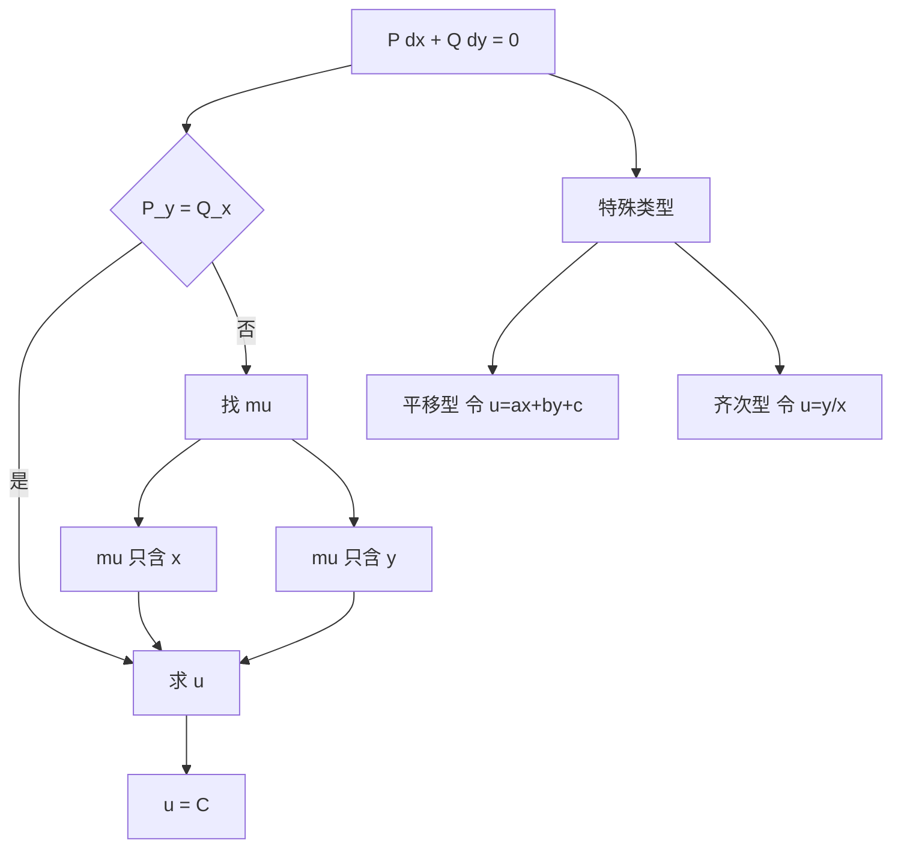

# 第 2 章：初等积分法

- **难度**：★★☆ | **预估学时**：10 小时 | **前置**：第 1 章、全微分
- **对应原书**：第二章

## 学习目标
学完本章，你能：
1. 以"恰当方程 + 积分因子"为主线重述全部初等解法；
2. 会用四种方式求 u：凑微分、折线积分、分组、公式；
3. 说明常数变易法为什么被推迟到线性方程组一章；
4. 处理形如 y′=f(ax+by+c) 的平移型方程。

## 一句话核心
丁同仁和李承治在这一章做了一个教学上的选择：**把恰当方程作为主线，其余方法都作为它的推论**。这不是数学上的必要，而是认知上的减负——你只需要记住一件事：凑全微分。

## 零基础讲解

### 2.1 恰当方程

P(x,y)dx + Q(x,y)dy = 0，P_y = Q_x

则存在 u 使 du=P dx+Q dy，解为 u=C。

**求 u 的三条路**：
1. **凑微分**：把 P dx+Q dy 拆成几组明显的全微分，例如 x dy+y dx=d(xy)。
2. **折线积分**：u=∫[x₀→x]P(t,y₀)dt+∫[y₀→y]Q(x,s)ds。
3. **先对一个变量积分再定函数**：u=∫P dx+φ(y)，代入 u_y=Q 定出 φ′(y)。

### 2.2 积分因子

不恰当时找 μ。教材强调：μ 的方程

μ(P_y−Q_x) + P μ_y − Q μ_x = 0

本身是一个一阶偏微分方程，一般难解。所以只处理 μ=μ(x) 与 μ=μ(y) 两种退化情形，判据就是两个商式。

**一个容易忽略的点**：若 μ 只依赖 x+y 或 xy，也可能可求。教材在习题里放了这类，但正文不展开。

### 2.3 一阶线性方程与常数变易

标准形 y′+P(x)y=Q(x)。教材在这里只给公式，把"常数变易"的系统讨论推迟到第六章（线性方程组）。这个安排有道理：常数变易的本质是"在解空间里换坐标"，用向量语言讲更清楚。

### 2.4 平移型与齐次型

**平移型** y′=f(ax+by+c)。令 u=ax+by+c，则 u′=a+b f(u)，变成变量分离。

**齐次型** y′=φ(y/x)。令 u=y/x，得 x u′=φ(u)−u。

这两类合起来覆盖了绝大多数"看起来不像分离变量"的一阶方程。

### 2.5 隐式方程

y=f(x,p) 与 x=f(y,p) 用参数 p 降阶；F(x,y,p)=0 一般只能局部解出。教材在这里的处理与其它教材一致，但更强调"参数化是一种坐标变换，不是新方法"。

## 图示

看图说明：图中所有箭头最终都指向"求 u"。这是本章唯一的终点。

## 类比与实例

**类比**：恰当方程像"已经写好的收据"——左边就是某笔账的总额变化；积分因子是"把零散的账目重新归并成一张收据"的操作。

**失效边界**：如果 μ 必须依赖 x 与 y 的复杂组合，归并就无法显式完成，方程也就"不可积"。

**实例**：解 (3x²+6xy²)dx+(6x²y+4y³)dy=0。
P_y=12xy，Q_x=12xy，恰当。凑微分：3x²dx+4y³dy+6xy²dx+6x²y dy = d(x³)+d(y⁴)+d(3x²y²)。
于是 u=x³+y⁴+3x²y²，解为 x³+3x²y²+y⁴=C。

## 常见误解

- **别以为"恰当方程一定是全微分形式一眼可见"**——实际上很多要分组凑。
- **别以为"积分因子只依赖一个变量才可求"**——实际上特殊组合也可能，但教材不展开。
- **别以为"常数变易是初等技巧"**——实际上它是线性代数观点，安排在方程组一章更合适。

## 自测题（答案）

1. 验证 (2x+y)dx+(x+2y)dy=0 恰当并求解。
   （答案：P_y=1=Q_x；u=x²+xy+y²；解 x²+xy+y²=C。解析：直接凑 d(x²)+d(xy)+d(y²)。）

2. 求 y′=f(2x+3y+1) 的换元。
   （答案：令 u=2x+3y+1，则 u′=2+3f(u)。解析：化为变量分离。）

3. 为什么 μ 的方程是一阶偏微分方程？
   （答案：因为 μ 依赖 x、y 两个变量，方程含 μ_x 与 μ_y。解析：一般难解，故只做退化情形。）

4. 折线积分法求 u 的公式？
   （答案：u=∫P(t,y₀)dt+∫Q(x,s)ds。解析：沿水平再沿竖直线段积分，路径无关性由恰当性保证。）

## 复习锚点
- 主线：凑全微分。
- 恰当判据 P_y=Q_x；不恰当找 μ。
- 平移型、齐次型都靠换元化为分离变量。
