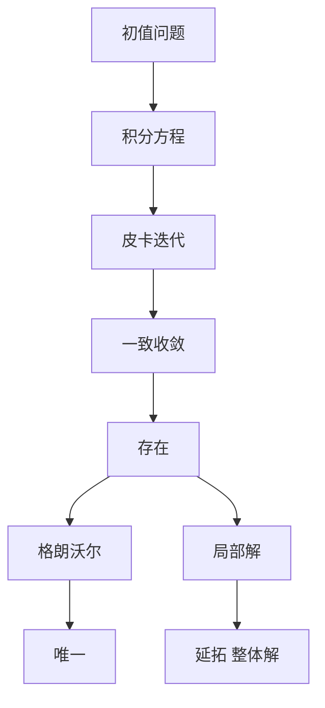

# 第 3 章：存在和唯一性定理

- **难度**：★★★ | **预估学时**：10 小时 | **前置**：第 2 章、一致收敛
- **对应原书**：第三章

## 学习目标
学完本章，你能：
1. 完整叙述并证明皮卡定理，包括 h 的取法与迭代估计；
2. 证明皮亚诺定理（连续即可存在），并说明它比皮卡弱在哪；
3. 说清"局部存在"与"整体存在"的差别；
4. 用格朗沃尔引理处理一切"差被积分控制"的情形。

## 一句话核心
丁同仁把存在性放在第三章、把"对初值的依赖"放到第五章，中间隔着奇解一章。这个顺序的意思是：**先保证有解，再看解怎么变，最后处理唯一性失效留下的尾巴。**

## 零基础讲解

### 3.1 皮卡定理

设 f(x,y) 在 R：|x−x₀|≤a，|y−y₀|≤b 连续，关于 y 满足李普希茨（常数 L）。则存在唯一解，定义在 |x−x₀|≤h，h=min(a, b/M)，M=max|f|。

**证明的四步**：
1. 化积分方程 y=y₀+∫f(t,y)dt。
2. 定义迭代 φₙ₊₁=y₀+∫f(t,φₙ)dt，并证明每个 φₙ 落在 R 内。
3. 估计相邻差 |φₙ₊₁−φₙ|≤M Lⁿ|x−x₀|ⁿ⁺¹/(n+1)!，得一致收敛。
4. 极限 φ 连续且满足积分方程（存在）；两个解作差用格朗沃尔（唯一）。

**注意第 2 步常被跳过**。如果没有它，第 3 步的 f(t,φₙ) 可能根本没有定义。

### 3.2 皮亚诺定理

只要求 f 连续。证明用欧拉折线 + Ascoli-Arzelà：折线族等度连续、一致有界，故有收敛子列，极限满足积分方程。

**为什么这里不能照搬皮卡？** 因为没有李普希茨，"相邻差"估计失效，迭代序列可能不收敛。

### 3.3 局部与整体

皮卡给的是局部解（|x−x₀|≤h）。整体存在需要延拓：只要解还在定义域内部，就继续接下去。

教材在这里给出延拓的判据：解在端点处若仍留在定义域内部，就能延伸；否则终止（到达边界或爆破）。

### 3.4 格朗沃尔引理的地位

它在本章只出现一次（唯一性），但会在第五章（连续依赖）、第六章（稳定性估计）反复出现。建议现在就把它当成一个独立工具记住：

D(x) ≤ A + ∫B D ⇒ D(x) ≤ A e^(B|x−x₀|)

## 图示

看图说明：注意"局部解"与"整体解"之间还有一步延拓，很多证明题漏掉这一步就开始讨论全局性质。

## 类比与实例

**类比**：皮卡迭代像"反复修草稿"：每一稿都比上一稿更接近真解，且误差按阶乘速度缩小。

**失效边界**：如果 f 在 y 方向变化太剧烈（不满足李普希茨），第 n 稿可能越来越乱，不收敛。

**实例**：y′=x+y，y(0)=0。迭代：
φ₀=0，φ₁=x²/2，φ₂=x²/2+x³/6，φ₃=x²/2+x³/6+x⁴/24。
极限是 eˣ−1−x。验证：y′=eˣ−1，而 x+y=x+eˣ−1−x=eˣ−1，成立。

## 常见误解

- **别以为"李普希茨条件必须显式给出"**——实际上只要 ∂f/∂y 在矩形上有界，就能取 L 为其上界。
- **别以为"皮亚诺定理更强"**——实际上它更弱：只保证存在。
- **别以为"局部解就是全部"**——实际上还要延拓。
- **别以为"格朗沃尔只能用在唯一性"**——实际上它是所有误差估计的通用工具。

## 自测题（答案）

1. 为什么迭代前必须证明 φₙ 落在 R 内？
   （答案：否则 f(t,φₙ(t)) 可能无定义，迭代无法继续。解析：R 是 f 的定义域。）

2. 皮亚诺定理的证明用了哪条紧性定理？
   （答案：Ascoli-Arzelà。解析：等度连续 + 一致有界 ⇒ 有收敛子列。）

3. h=min(a,b/M) 中 b/M 的作用？
   （答案：保证 |φₙ(x)−y₀|≤M|x−x₀|≤Mh≤b，不跑出矩形。解析：这是第 2 步的核心估计。）

4. 延拓终止的两种情形？
   （答案：抵达定义域边界，或解在有限时间爆破。解析：如 y′=y² 的解在 1 处爆破。）

## 复习锚点
- 皮卡：连续 + 李普希茨 ⇒ 唯一；皮亚诺：连续 ⇒ 存在。
- 四步证明：积分方程、迭代、估计、收敛 + 格朗沃尔。
- 局部 → 延拓 → 整体。
