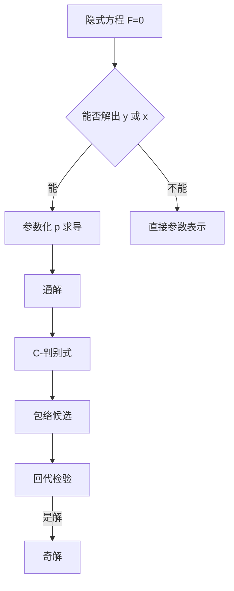

# 第 4 章：一阶隐式方程与奇解

- **难度**：★★★ | **预估学时**：7 小时 | **前置**：第 2、3 章
- **对应原书**：第四章

## 学习目标
学完本章，你能：
1. 解 p-可解型与 x-可解型隐式方程，写出参数形式的通解；
2. 区分"奇解"与"通解中的某个特解"；
3. 用 p-判别式与 C-判别式求包络，并回代检验；
4. 说明奇解存在与唯一性失效的关系。

## 一句话核心
奇解不是"算出来的一个解"，而是"唯一性失效处露出来的另一族解"。第四章放在存在唯一性之后，正是因为它必须用第三章的定理来解释。

## 零基础讲解

### 4.1 隐式方程的四类

**第一类** y=f(x,p)：对 x 求导得 p=f_x+f_p·dp/dx，解出 p 后再积分。
**第二类** x=f(y,p)：把 dx/dy=1/p，得 1/p=f_y+f_p·dp/dy。
**第三类** F(x,y,p)=0：若能解出 y 或 x，归入前两类；否则用参数化。
**第四类** 克莱罗与拉格朗日型：有专门的技巧。

### 4.2 奇解的定义

**奇解**：本身是解，且在其上每一点都与通解族中某条曲线相切，但不属于通解族。

三个条件缺一不可：是解、相切、不在族内。只说"不在族内"不够——y≡0 对 y′=y² 也不在族内，但它不是奇解（它不与任何解曲线相切）。

### 4.3 判别式

**p-判别式**：从 F(x,y,p)=0 与 F_p(x,y,p)=0 消去 p。
**C-判别式**：从通解 Φ(x,y,C)=0 与 Φ_C=0 消去 C。

两者都只是**候选**。p-判别式可能包含"根本不是解"的曲线（例如 F=(y′−y)(y′−1)=0 的判别式可能给出奇怪的东西），必须回代检验。

### 4.4 奇解与唯一性的关系

奇解上的每一点，初值问题的解都不唯一：一条是经过该点的通解曲线，另一条是奇解本身。这正是第三章李普希茨条件失效的几何表现。

**定理**（简述）：若 f 在奇解附近满足李普希茨，则不会有奇解穿过。所以奇解一定出现在"李普希茨失效"的地方。

## 图示

看图说明：右侧那条"判别式 → 检验"的链条是最容易省略的一步。省略了就会把"假奇解"写进答案。

## 类比与实例

**类比**：通解族像一摞同心圆，奇解像它们的外公切线。每条圆都与公切线相切，但公切线本身不是任何一条圆。

**失效边界**：如果曲线族彼此相交（不是"族"而是"网"），包络的概念就不适用。

**实例**：y=xp+p²。求导得 (x+2p)dp/dx=0。
分支一：p=C，y=Cx+C²（直线族）。
分支二：x=−2p，代回 y=−2p²+p²=−p²，即 y=−x²/4。
检验：y′=−x/2，而 xp+p²=x(−x/2)+x²/4=−x²/4=y，成立。且直线 y=Cx+C² 在 x=−2C 处与抛物线相切。所以 y=−x²/4 是奇解。

## 常见误解

- **别以为"p-判别式给出的曲线一定是奇解"**——实际上必须回代。
- **别以为"奇解就是不在通解里的解"**——实际上还要相切条件。
- **别以为"奇解只出现在克莱罗方程"**——实际上任何唯一性失效处都可能出现。

## 自测题（答案）

1. 奇解的三个条件？
   （答案：是解、与族中曲线相切、不属于族。解析：缺一不可。）

2. 为什么奇解必然对应李普希茨失效？
   （答案：若李普希茨成立，解唯一，不可能有两条曲线经过同一点相切。解析：这是第三章定理的直接推论。）

3. 解 y=xp+p³ 的奇解。
   （答案：x+3p²=0 ⇒ p=±√(−x/3)，y=−2p³，消参得 y=±(2/3)√(−x/3)³。解析：注意定义域 x≤0。）

4. C-判别式与 p-判别式的区别？
   （答案：前者从通解消 C，后者从方程消 p。解析：前者给包络候选，后者给"奇异曲线"候选。）

## 复习锚点
- 隐式方程靠参数 p 降阶。
- 奇解 = 解 + 相切 + 不在族内。
- 判别式只给候选，必须回代。
