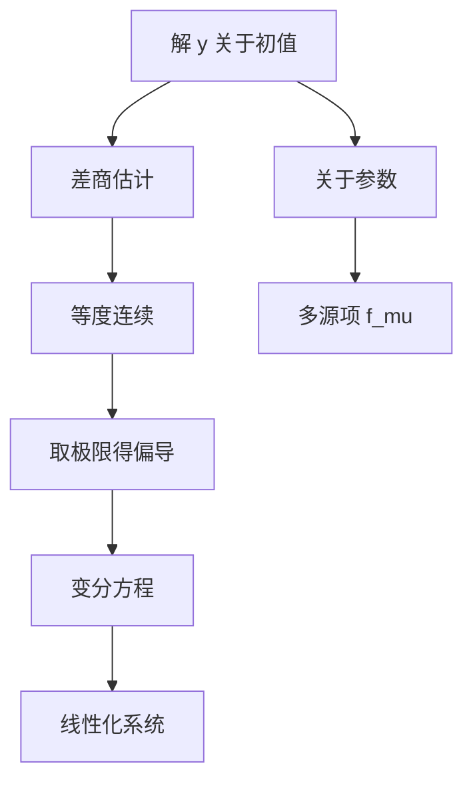

# 第 5 章：解对初值和参数的连续可微性

- **难度**：★★★ | **预估学时**：8 小时 | **前置**：第 3 章、矩阵、多元微积分
- **对应原书**：第五章

## 学习目标
学完本章，你能：
1. 在 m 维框架下写出解对初值的连续依赖估计；
2. 证明解对初值连续可微，并写出变分方程；
3. 说明解对参数的连续可微性；
4. 解释"整体定理"与"局部定理"在证明上的差别。

## 一句话核心
存在唯一性告诉你"有一条解"，本章告诉你"这条解是初值和参数的光滑函数"。**光滑性是后续一切线性化、稳定性、灵敏度分析的前提。**

## 零基础讲解

### 5.1 m 维框架

把高阶方程化为一阶方程组后，状态是 Rᵐ 中的向量：

dy/dx = f(x, y)，y∈Rᵐ

所有估计都用向量范数写。这一步的意义不是"更抽象"，而是"只证一次"。

### 5.2 连续依赖

|y(x;x₀,y₀) − y(x;x₀,y₁)| ≤ |y₀−y₁|·e^(L|x−x₀|)

证明就是两解作差 + 格朗沃尔。教材在这里补了一个细节：若 f 只在局部满足李普希茨，估计只在公共存在区间上成立，不能无限外推。

### 5.3 连续可微

∂y/∂y₀ 存在且连续，满足变分方程

Φ′ = f_y(x,y(x))·Φ，Φ(x₀)=I

**证明的关键**：不能直接对积分方程求导（f 未必对 y 可微到可以交换次序），要先做差商估计，证明差商一致有界且等度连续，再取极限。

教材把这一步写得很细，因为它正是"局部定理"和"整体定理"的技术分界：局部只需李普希茨，整体可微需要 f 对 y 连续可微。

### 5.4 对参数的可微

含参数 μ 时，∂y/∂μ 满足

d/dx(∂y/∂μ) = f_y·(∂y/∂μ) + f_μ

与变分方程相比多一个源项 f_μ。

## 图示

看图说明：上方那条链是"先估计差商，再取极限"，不能跳过；下方是参数情形，结构相同但多一项。

## 类比与实例

**类比**：解对初值的依赖像"调收音机旋钮"：旋一点点，声音变一点点，而且变化是连续的。变分方程描述的就是"旋钮转一格的音量变化率"。

**失效边界**：如果系统有分支点（比如参数跨过临界值），这个光滑依赖可能在某点失效——解的数量会突变。

**实例**：y′=μ y，y(0)=1。解 y=e^(μx)。∂y/∂μ=x e^(μx)，∂y/∂y₀=e^(μx)。
验证灵敏度方程：d/dx(x e^(μx))=e^(μx)+μx e^(μx)=μ(x e^(μx))+1·e^(μx)，其中 f_μ=y=e^(μx)。成立。

## 常见误解

- **别以为"连续依赖是废话"**——实际上它给了指数放大的定量界，是数值稳定性的理论依据。
- **别以为"偏导存在是显然的"**——实际上需要 f 对 y 连续可微，仅李普希茨不够。
- **别以为"整体定理与局部定理只差区间长度"**——实际上整体定理要额外假设解在紧集上存在。

## 自测题（答案）

1. 连续依赖估计的放大因子？
   （答案：e^(L|x−x₀|)。解析：格朗沃尔引理给出。）

2. 变分方程的初值为什么是 I？
   （答案：∂y/∂y₀ 在 x₀ 处为恒等映射的导数。解析：y(x₀)=y₀。）

3. 参数情形比初值情形多哪一项？
   （答案：f_μ。解析：参数直接进入方程产生源项。）

4. 为什么证明可微性要先做差商估计？
   （答案：不能直接交换求导与积分次序，需先证差商一致收敛。解析：这是分析里的标准手法。）

## 复习锚点
- 连续依赖 = 格朗沃尔 + 指数界。
- 可微性 = 差商估计 + 变分方程。
- 参数情形多 f_μ。
