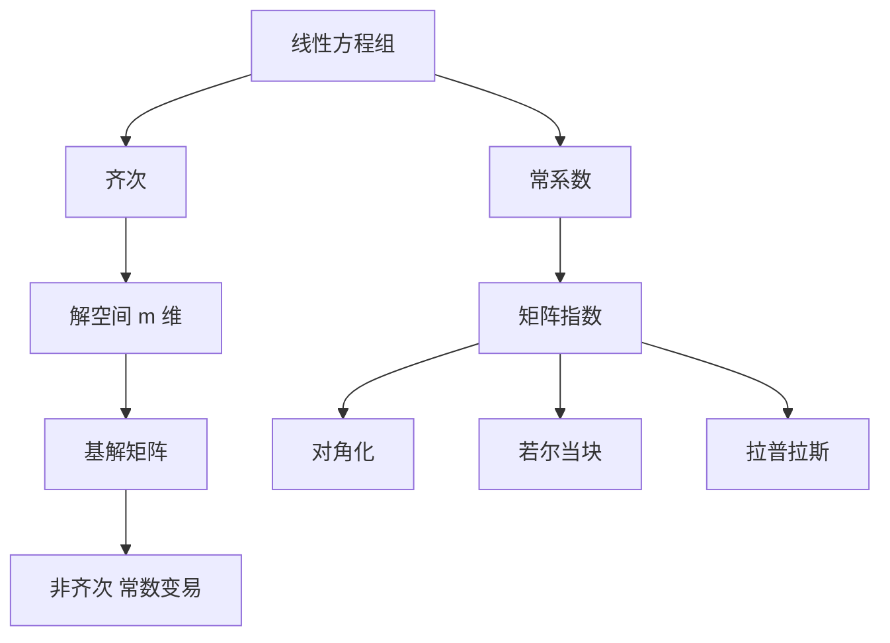

# 第 6 章：线性微分方程组与高阶线性方程

- **难度**：★★★ | **预估学时**：10 小时 | **前置**：第 5 章、线性代数
- **对应原书**：第六章

## 学习目标
学完本章，你能：
1. 写出齐次线性方程组解空间的维数定理；
2. 用基解矩阵与常数变易解非齐次方程组；
3. 把常系数情形化为矩阵指数，并处理重特征值；
4. 说明高阶线性方程是方程组的特例，反之亦然。

## 一句话核心
线性理论的全部内容可以概括为：**解空间是有限维线性空间，非齐次 = 特解 + 齐次**。其余都是算法。

## 零基础讲解

### 6.1 齐次方程组

dy/dx = A(x)y

解集是 m 维线性空间。基解矩阵 Φ 满足 Φ′=AΦ，det Φ≠0。

**维数定理的证明**：映射 y₀ ↦ y(x;x₀,y₀) 是从 Rᵐ 到解空间的线性同构（线性来自方程对 y 的线性性，双射来自存在唯一性）。所以维数等于 m。

### 6.2 非齐次与常数变易

y = Φ(x)[C + ∫Φ⁻¹(s)f(s)ds]

**这个公式的推导本身就是"换坐标"**：在 Φ 这组基下，非齐次项 f 被 Φ⁻¹ 翻译成"坐标的变化率"，再积分。

### 6.3 常系数与矩阵指数

A 为常数时，e^(At) 是标准基解矩阵。计算三条路：对角化、若尔当块、待定系数（拉普拉斯变换作为第四条）。

重特征值出现 t 的幂，原因是广义特征向量链，与若尔当块同构。

### 6.4 高阶方程的互化

n 阶方程 → 一阶方程组（令 y₁=y,…,yₙ=y⁽ⁿ⁻¹⁾）。
一阶方程组 → n 阶方程（消元，取某个分量的最高阶导数方程）。

两种写法信息量相同，但方程组写法更适合用矩阵工具，高阶写法更适合用特征多项式。

## 图示

看图说明：中间"解空间 m 维"是全部结论的根。下面所有算法都只是在具体计算这个空间的基。

## 类比与实例

**类比**：基解矩阵像一组"坐标轴"。解向量在这组轴下的坐标是常数 C；非齐次项相当于不断推动坐标轴，让坐标随时间变。

**失效边界**：非线性系统没有这种"固定坐标轴"的结构，所以常数变易只对线性方程有效。

**实例**：A=[[1,2],[0,3]]，e^(At)=[[e^t, e^(3t)−e^t],[0, e^(3t)]]。
验证：对 (1,2) 元素求导得 3e^(3t)−e^t，而 A e^(At) 的第一行第二列 = 1·(e^(3t)−e^t)+2·e^(3t)=3e^(3t)−e^t，一致。

## 常见误解

- **别以为"基解矩阵必须由特征向量组成"**——实际上任何线性无关解都行。
- **别以为"矩阵指数可以对每个元素取指数"**——实际上只有对角矩阵才行。
- **别以为"高阶方程与方程组不能互化"**——实际上两者可以互相转化。

## 自测题（答案）

1. 齐次线性方程组解空间的维数？
   （答案：m，即未知量的个数。解析：由初值到解的线性同构。）

2. 常数变易公式中 Φ⁻¹ 的作用？
   （答案：把非齐次项翻译成基坐标下的分量。解析：相当于坐标变换。）

3. A=[[2,0],[0,2]] 的 e^(At)？
   （答案：e^(2t)I。解析：对角矩阵，逐元素取指数成立。）

4. 为什么重特征值会出现 t 的幂？
   （答案：广义特征向量链，与若尔当块相关。解析：见 e^(λt)(I+Nt+…) 形式。）

## 复习锚点
- 齐次解空间 m 维，非齐次 = 特解 + 齐次。
- 常数变易 = 换坐标。
- 常系数看矩阵指数，重根看若尔当块。
