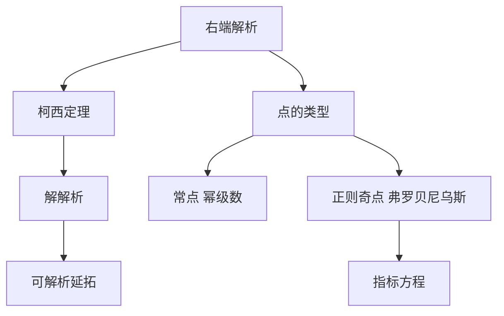

# 第 7 章：解析理论

- **难度**：★★★ | **预估学时**：6 小时 | **前置**：第 3、5、6 章、复变函数
- **对应原书**：第七章

## 学习目标
学完本章，你能：
1. 陈述柯西定理并说明"解析"与"连续可微"的等级差别；
2. 用幂级数求常点附近的解，写出系数递推；
3. 判断正则奇点并用弗罗贝尼乌斯方法；
4. 说明为什么解析理论对复数域比实数域更自然。

## 一句话核心
解析理论的核心不是"级数解法"，而是"解析函数类对微分方程运算封闭"。这个封闭性让解可以一直被解析延拓下去。

## 零基础讲解

### 7.1 柯西定理

若 f(x,y) 在 (x₀,y₀) 邻域内解析，则解在 x₀ 邻域内解析。

证明用优级数：把 f 的系数用一个正项级数压住，证明解的系数被它控制。

**与皮卡定理的区别**：皮卡只要连续 + 李普希茨，给 C⁰ 解；柯西要解析，给 C^ω 解。等级不同，结论不同。

### 7.2 常点与幂级数

把 y=Σaₖ(x−x₀)ᵏ 代入，比较同次幂。n 阶线性方程给出 k 阶递推（k 从 0 到 ∞），初值决定 a₀,…,a_{n−1}。

**收敛半径**：不小于初值点到最近奇点的距离。这条估计在工程上非常有用——它告诉你"级数解能用多远"。

### 7.3 正则奇点与弗罗贝尼乌斯

方程 y″+p y′+q y=0，若 (x−x₀)p、(x−x₀)²q 解析，则 x₀ 是正则奇点。设

y=(x−x₀)^r Σaₖ(x−x₀)ᵏ

代入最低次幂得指标方程 r(r−1)+p₀r+q₀=0（p₀、q₀ 是 p、q 展开的常数项）。

两根之差非整数 ⇒ 两个独立级数解；为整数 ⇒ 第二个解可能带对数。

### 7.4 为什么用复域

在实轴上，解析延拓会遇到奇点而中断；在复平面上，解析函数可以由一个局部级数唯一确定到整个连通区域。这是"解析"比"实可微"强得多的地方。

## 图示

看图说明：上支是"解析性带来的全局能力"，下支是"局部计算的方法选择"。两者都要会。

## 类比与实例

**类比**：解析性像"完整的 DNA"。知道一小段（局部级数），就能复原整个个体（全局函数）；只连续可微则像"只知道长相"，换个角度就认不出了。

**失效边界**：如果函数只在实轴上解析但在复平面有奇点（如 1/(1+x²)），解析延拓的半径会被复奇点限制。

**实例**：y″+y/x−y/x²=0 在 x=0 处。p=1/x，q=−1/x²，x p=1，x²q=−1 都解析，故为正则奇点。指标方程 r(r−1)+r−1=0 ⇒ r²−1=0 ⇒ r=±1。

## 常见误解

- **别以为"解析就是可导"**——实际上解析是可导的强得多的条件（局部可展成幂级数）。
- **别以为"正则奇点一定有级数解"**——实际上指标方程两根差整数时第二个解要对数。
- **别以为"收敛半径由方程阶数决定"**——实际上由奇点位置决定。

## 自测题（答案）

1. 柯西定理与皮卡定理的等级差别？
   （答案：前者给解析解，后者只给连续可微解。解析：假设不同。）

2. 正则奇点的指标方程怎么来？
   （答案：代入最低次幂，令系数为零。解析：r(r−1)+p₀r+q₀=0。）

3. 收敛半径由什么决定？
   （答案：到最近奇点的距离。解析：复平面上的奇点也算。）

4. 为什么解析理论在复域更自然？
   （答案：解析函数由局部级数唯一确定，可延拓。解析：实轴上延拓会中断。）

## 复习锚点
- 解析右端 ⇒ 解析解。
- 常点幂级数，正则奇点弗罗贝尼乌斯。
- 收敛半径看最近奇点。
