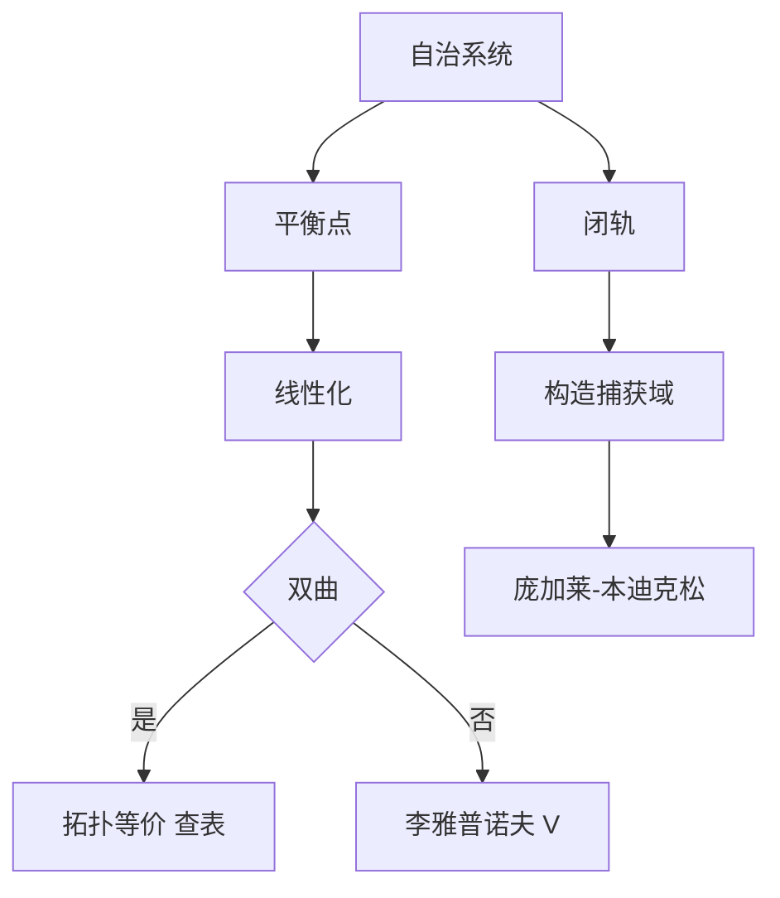

# 第 8 章：定性理论

- **难度**：★★★ | **预估学时**：10 小时 | **前置**：第 5、6 章、拓扑初步
- **对应原书**：第八章

## 学习目标
学完本章，你能：
1. 用动力系统语言描述自治方程（相空间、轨线、不变集）；
2. 证明李雅普诺夫稳定性定理与渐近稳定性定理；
3. 按迹与行列式分类平面线性系统的奇点；
4. 用庞加莱-本迪克松定理证明闭轨存在；
5. 说明结构稳定性与分支的含义。

## 一句话核心
定性理论放弃"求出解"，改问"轨线的整体排布"。它的两个支柱是：**李雅普诺夫函数**（判稳）与**庞加莱-本迪克松定理**（判闭轨存在）。

## 零基础讲解

### 8.1 动力系统的基本对象

自治系统 dx/dt=f(x) 定义相流。基本对象：轨线、平衡点、周期轨、不变集、极限集（ω 极限集、α 极限集）。

**不变集**：若轨线某一时刻进入就不再离开。闭轨、平衡点、环面都是不变集。

### 8.2 李雅普诺夫定理

**稳定性**：对任意 ε，存在 δ，初值在 δ 内则轨线永远在 ε 内。
**渐近稳定性**：稳定且 t→∞ 时趋于平衡点。

**第一方法（线性化）**：A=f′(0) 的特征值实部全负 ⇒ 渐近稳定。
**第二方法（V 函数）**：V 正定、V̇ 负半定 ⇒ 稳定；V̇ 负定 ⇒ 渐近稳定。

第二方法的威力在于：不必解方程，也不必算特征值。代价是"构造 V 没有通用算法"。

### 8.3 平面奇点分类

线性系统 dx/dt=Ax，p=tr A，q=det A，Δ=p²−4q：

| 条件 | 类型 | 稳定性 |
|---|---|---|
| q<0 | 鞍点 | 不稳定 |
| q>0, Δ>0, p<0 | 稳定结点 | 渐近稳定 |
| q>0, Δ>0, p>0 | 不稳定结点 | 不稳定 |
| q>0, Δ<0, p<0 | 稳定焦点 | 渐近稳定 |
| q>0, Δ<0, p>0 | 不稳定焦点 | 不稳定 |
| q>0, Δ<0, p=0 | 中心 | 稳定非渐近 |

**非线性情形**：双曲平衡点（p≠0）的局部相图与线性化拓扑等价（哈特曼-格罗布曼定理），所以上表可以照用。

### 8.4 闭轨与庞加莱-本迪克松

**定理**：平面自治系统若存在有界闭区域 D，轨线进入后不离开，且 D 内无平衡点，则 D 内存在闭轨。

用法：构造一个"环状"trapping region，外边界向内、内边界向外。

### 8.5 结构稳定与分支

结构稳定：参数微小变化不改变相图拓扑。分支：参数变化导致拓扑改变。这是"定性理论"走向现代动力系统的入口。

## 图示

看图说明：左右两支解决两个不同问题——局部稳定性与全局闭轨。考卷上的综合题常常两者都要。

## 类比与实例

**类比**：V 函数像"海拔"。轨线总是往低处走，就不可能翻出山谷，于是稳定；如果谷底唯一，就渐近稳定。

**失效边界**：如果 V̇ 只在部分区域负定，结论只在那个区域成立。

**实例**：Duffing 型 x″+x³=0 等价于 V=x′²/2+x⁴/4 守恒，轨线在等能线上；V 正定、V̇=0，只能得"稳定"，不是渐近稳定。这与中心型一致。

## 常见误解

- **别以为"线性化总能判稳"**——实际上非双曲时失效。
- **别以为"V 必须是能量"**——实际上任何正定函数都行。
- **别以为"庞加莱-本迪克松定理对三维也成立"**——实际上只在平面成立。
- **别以为"稳定就是渐近稳定"**——实际上中心型稳定但不渐近。

## 自测题（答案）

1. p=0、q>0 的线性系统是什么奇点？
   （答案：中心。解析：特征值为纯虚数。）

2. 第二方法判渐近稳定的条件？
   （答案：V 正定且 V̇ 负定。解析：负半定只能给稳定。）

3. 庞加莱-本迪克松定理的三个条件？
   （答案：平面、有界捕获域、域内无平衡点。解析：三者缺一不可。）

4. 结构稳定的含义？
   （答案：参数微扰不改变相图拓扑。解析：分支点处结构不稳定。）

## 复习锚点
- 平衡点：先线性化，双曲则查表。
- 非双曲：找 V。
- 闭轨：庞加莱-本迪克松。
