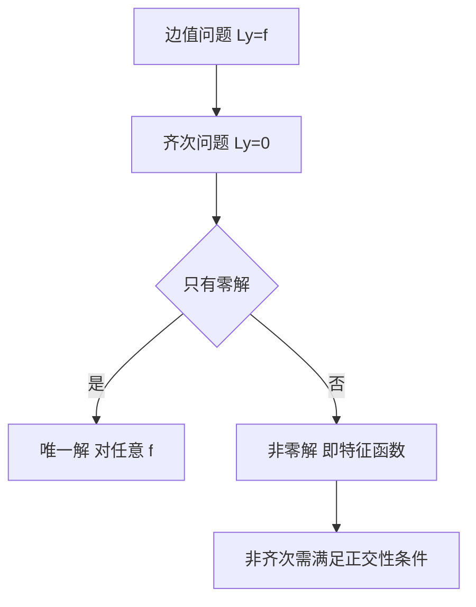

# 第 9 章：边值问题

- **难度**：★★★ | **预估学时**：8 小时 | **前置**：第 6 章、泛函分析初步
- **对应原书**：第九章

## 学习目标
学完本章，你能：
1. 区分初值问题与边值问题在"解的存在性"上的差别；
2. 写出斯特姆-刘维尔问题的标准形并说明自伴性；
3. 证明特征值的实数性与特征函数的正交性；
4. 说明为什么边值问题的特征值是可数无穷的。

## 一句话核心
边值问题的困难在于：**同样的方程，边界条件一变，解可能从"唯一"变成"无穷多"或者"没有"**。这是初值问题不会出现的情况。

## 零基础讲解

### 9.1 与初值问题的根本差别

初值问题：给 x₀ 处的 n 个条件，由存在唯一性定理保证局部唯一。
边值问题：给 a、b 两端的条件，条件数与方程阶数相同，但不保证唯一。

**反例**：y″+y=0，y(0)=0，y(π)=1 无解；y(0)=0，y(π)=0 有无穷多解（A sin x）。同一个方程，边界条件不同，结论完全不同。

原因：边值问题本质是"线性算子方程"，其可解性取决于算子是否可逆，而可逆性又取决于特征值是否落在参数上。

### 9.2 斯特姆-刘维尔问题

(p y′)′ + (λρ−q)y = 0，a<x<b

配分离边界条件。关键性质：
1. 特征值 λ 是实数，且可数，趋于 +∞；
2. 不同特征值的特征函数带权 ρ 正交；
3. 特征函数系在 L²_ρ 中完备，可展开任意平方可积函数。

**为什么可数**：这是紧自伴算子谱的离散性，直观上"区间有限 + 方程正则"限制了振荡次数。

### 9.3 存在性与唯一性的判据

对线性边值问题 Ly=f，齐次问题只有零解 ⇔ 非齐次问题对任意 f 有唯一解（弗雷德霍姆二择一）。

这条判据把"解是否存在"转化为"齐次问题有没有非零解"，比直接求解省力得多。

## 图示

看图说明：这张图是本章的"决策树"。拿到边值问题，先解齐次，再决定走哪条路。

## 类比与实例

**类比**：边值问题像"两端固定的弦"。你能拨出无数种驻波（特征函数），但要让弦在某个频率下按你指定的形状振动，通常做不到。

**失效边界**：如果边界条件含非线性项，弗雷德霍姆二择一不再适用。

**实例**：y″+λy=0，y′(0)=0，y′(π)=0。特征值 λ=n²，特征函数 cos nx（n=0,1,2,…）。
验证正交：∫₀^π cos mx cos nx dx=0（m≠n），n=0 时 cos 0=1 也正交。

## 常见误解

- **别以为"边值问题一定有解"**——实际上可能无解，如 y(0)=0、y(π)=1。
- **别以为"特征值一定是正的"**——实际上 q 为负时可能出现负特征值。
- **别以为"正交性需要特征值互异"**——实际上重特征值的特征函数可以正交化。

## 自测题（答案）

1. y″+y=0，y(0)=0，y(π)=1 有解吗？
   （答案：无解。解析：通解 A sin x + B cos x，B=0，A sin π=0≠1。）

2. 弗雷德霍姆二择一的内容？
   （答案：齐次只有零解 ⇔ 非齐次对任意 f 唯一可解。解析：这是线性算子可逆性的等价表述。）

3. 特征函数正交的权是什么？
   （答案：ρ(x)。解析：∫ρ yₘ yₙ=0。）

4. 为什么特征值可数？
   （答案：紧自伴算子的谱离散。解析：区间有限 + 正则性限制振荡次数。）

## 复习锚点
- 边值问题可能无解或无穷多解。
- 先解齐次，再用二择一。
- S-L 问题：实特征值 + 正交 + 完备。
