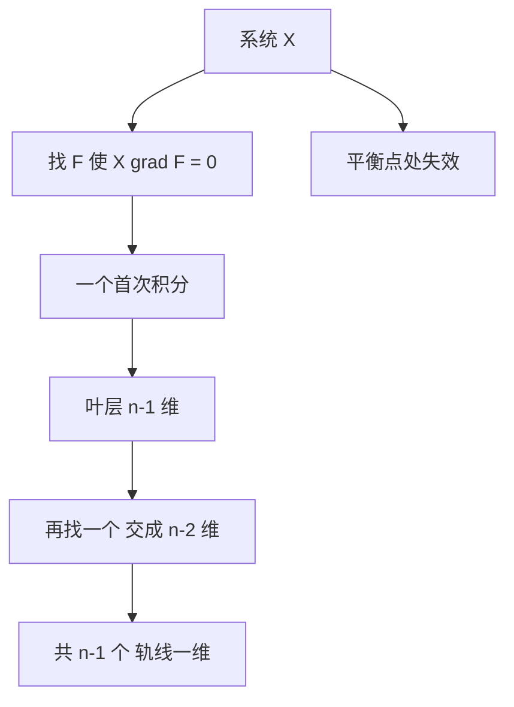

# 第 10 章：首次积分

- **难度**：★★★ | **预估学时**：7 小时 | **前置**：第 6、8 章
- **对应原书**：第十章

## 学习目标
学完本章，你能：
1. 给出首次积分的定义并验证一个函数是否为首次积分；
2. 说清独立首次积分与轨线维数的关系；
3. 用"找 n−1 个首次积分"的方法判断轨线形状；
4. 区分局部首次积分与整体首次积分。

## 一句话核心
首次积分是"守恒量"的数学名字。**每多一个独立首次积分，相空间的有效维数就少一维**；找到 n−1 个，轨线就被钉死成一维曲线。

## 零基础讲解

### 10.1 定义

F(x₁,…,xₙ) 沿系统 dx/dt=X(x) 的每条轨线取常数，等价于

X·∇F = ∂F/∂x₁·X₁ + … + ∂F/∂xₙ·Xₙ = 0

### 10.2 独立性与维数

若 F₁,…,Fₖ 的梯度在某区域线性无关，则它们把区域切成 n−k 维的叶层。轨线落在这些叶层的交里，所以 k=n−1 时轨线是一维。

**这就是"n 维系统最多 n−1 个独立首次积分"的原因**——不是定理的限制，而是维数计数。

### 10.3 局部与整体

局部：在非平衡点附近一定能找到 n−1 个（把向量场拉直即可）。
整体：可能存在"障碍"——轨线的全局行为（如回归性、稠密性）会阻止一个单值光滑的首次积分存在。

教材在这里的讨论比一般工科教材深，值得留意：**"局部有"不等于"整体有"**。

### 10.4 用首次积分判断轨线

以 Volterra 模型为例，H=x−c ln x + b y − a ln y 是首次积分，H 的等值线是闭曲线，故轨线是闭的——不需要解方程就能得到"周期振荡"的结论。

## 图示

看图说明：中间那条链是"维数递减"。右侧提醒：平衡点处向量场为零，拉直法失效，需单独处理。

## 类比与实例

**类比**：首次积分像"能量表"。系统的能量不变，所以状态只能沿着"等能量面"移动；再知道一个守恒量（角动量），就只剩一条线可走。

**失效边界**：耗散系统没有这样的守恒量，首次积分可能根本不存在。

**实例**：谐振子 x″+x=0。取 F=x′²/2+x²/2，验证：X=(x′,−x)，∇F=(x,x′)，点积=x′x+(−x)x′=0。所以 F 是首次积分，轨线是椭圆。

## 常见误解

- **别以为"首次积分就是解"**——实际上它是守恒量，不是轨线本身。
- **别以为"n 维系统一定有 n 个首次积分"**——实际上独立的只有 n−1 个。
- **别以为"局部存在就能拼成整体"**——实际上可能有全局障碍。

## 自测题（答案）

1. 验证 F=x²+y² 是否为 x′=−y、y′=x 的首次积分。
   （答案：是。解析：∇F=(2x,2y)，X=(−y,x)，点积=−2xy+2xy=0。）

2. 为什么独立首次积分最多 n−1 个？
   （答案：每多一个，维数降一；轨线本身一维，故最多降 n−1 次。解析：维数计数。）

3. 局部存在性用什么方法证明？
   （答案：局部坐标把向量场拉直，化为解 n−1 个方程。解析：需向量场非零。）

4. Volterra 模型为什么有周期解？
   （答案：首次积分的等值线闭合。解析：H 在平衡点取极小。）

## 复习锚点
- 首次积分 = 沿轨线不变的函数。
- 独立的有 n−1 个，维数递减。
- 局部有 ≠ 整体有。
