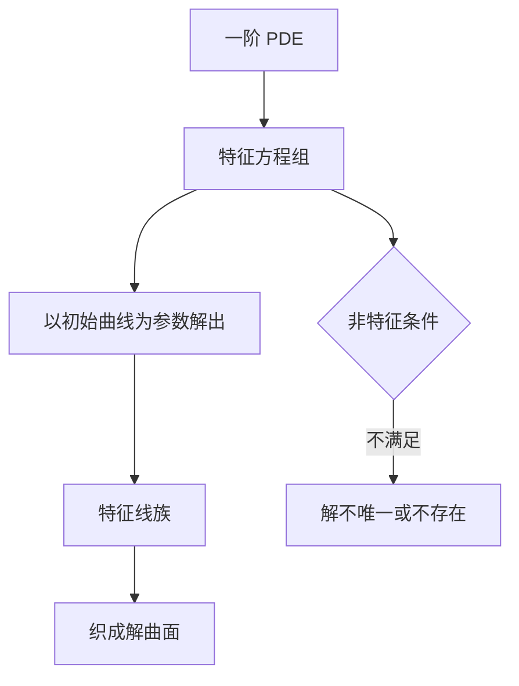

# 第 11 章：一阶偏微分方程

- **难度**：★★★ | **预估学时**：6 小时 | **前置**：第 2、10 章
- **对应原书**：第十一章

## 学习目标
学完本章，你能：
1. 用首次积分写出齐次线性 PDE 的通解；
2. 用特征线法解拟线性方程，写出参数形式的解；
3. 判断初始曲线是否满足非特征条件；
4. 说明完全积分与通解的区别。

## 一句话核心
一阶 PDE 的解法只有一个核心动作：**沿特征线把偏导降为常导**。剩下的都是这句话的技术展开。

## 零基础讲解

### 11.1 齐次线性 PDE

a(x,y)u_x + b(x,y)u_y = 0

其特征方程 dy/dx=b/a 的首次积分 Φ(x,y)=C。通解 u=F(Φ)。

**为什么**：沿特征线，u 的全导数 du/ds=a u_x+b u_y=0，所以 u 在该线上为常数；不同线可以取不同常数，这个"不同"就是一个任意函数。

### 11.2 拟线性

a(x,y,u)u_x + b(x,y,u)u_y = c(x,y,u)

特征方程组

dx/ds=a，dy/ds=b，du/ds=c

给定初始曲线 Γ:(x₀(τ),y₀(τ),u₀(τ))，解上述方程组（以 τ 为参数），得到一族特征线，它们织成解曲面。

### 11.3 非特征条件

a·dy₀/dτ − b·dx₀/dτ ≠ 0

几何意义：初始曲线的切方向不能与特征方向重合。否则从初始条件无法定出 u 的法向导数，解不唯一或不存在。

### 11.4 完全积分

对 F(x,y,u,p,q)=0，完全积分是含两个参数的解族 u=φ(x,y;c₁,c₂)。奇解由包络给出。这个概念在哈密顿-雅可比理论里有大用，但本章只需知道它存在。

## 图示

看图说明：这是一条"从曲线族到曲面"的生产线。非特征条件是质检关卡，过不了就出不了合格品。

## 类比与实例

**类比**：特征线是经线，初始曲线是纬线。经纬一交，整张地图就确定下来；如果初始曲线本身是经线，那就定不了纬线。

**失效边界**：特征线在有限距离内相交时，解曲面出现折痕（激波），经典解失效。

**实例**：u_x+u_y=0，u(x,0)=sin x。
特征方向 (1,1)，初始曲线 (τ,0)，非特征条件 1·0−1·1=−1≠0，满足。
特征线 x−y=τ，u 沿之不变，故 u=sin(x−y)。验证：u_x=cos(x−y)，u_y=−cos(x−y)，和为 0。边界 y=0 时 sin x。成立。

## 常见误解

- **别以为"任意初始曲线都行"**——实际上必须横截特征方向。
- **别以为"通解就是所有解"**——实际上可能有奇解（包络）。
- **别以为"一阶 PDE 只有一个方法"**——实际上还有完全积分、拉格朗日-夏皮罗等方法，但主线仍是特征线。

## 自测题（答案）

1. 齐次 PDE 通解的形式？
   （答案：u=F(Φ)，Φ 为首次积分。解析：沿特征线 u 为常数。）

2. 非特征条件的式子？
   （答案：a·dy₀/dτ−b·dx₀/dτ≠0。解析：切向不能与特征向重合。）

3. u_x+2u_y=0，u(x,0)=x² 的解？
   （答案：u=(x−y/2)²。解析：特征线 x−y/2=τ。）

4. 特征线相交会发生什么？
   （答案：解曲面出现折痕，经典解失效。解析：需要弱解理论。）

## 复习锚点
- 特征线法 = 把偏导降为常导。
- 齐次通解 u=F(Φ)。
- 非特征条件必须验证。
