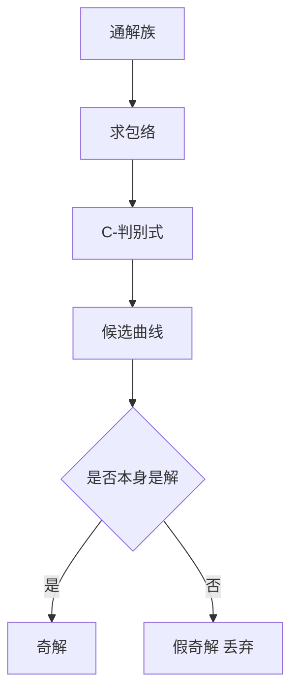

# 奇解与包络

- **难度**：进阶 | **涉及章节**：第 4 章

## 一句话定义
既是解、又与通解族中每条曲线相切、但不属于通解族的曲线。

## 为什么重要
它是"唯一性失效"的几何面孔：在奇解上，初值问题的解不唯一。

## 图示

## 详解
包络是"贴着族中每条曲线走、但自己不是其中一条"的曲线。判别式只是找包络的代数手段，找到后必须回代验证。

在奇解的点上，李普希茨条件必然失效，否则唯一性会禁止两条曲线相切而过。

## 常见误解
- 别以为判别式给出的都是奇解。
- 别以为不在通解族里的解都是奇解（还要相切）。
- 别以为奇解只属于隐式方程（显式方程也可能有）。

## 在书中出现的脉络
| 章节 | 语境 | 关键结论 |
|---|---|---|
| 第 4 章 | 隐式方程 | p-判别式、C-判别式 |
| 第 3 章 | 唯一性 | 李普希茨失效 |

## 相关概念
- 前置：包络、隐函数定理
- 后续：分支理论
