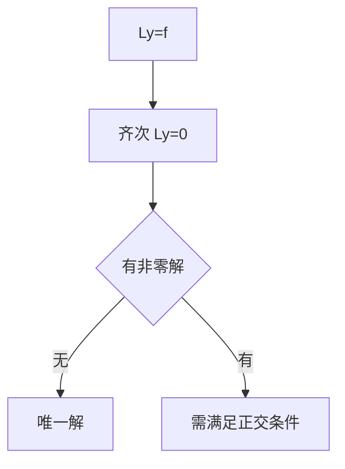

# 弗雷德霍姆二择一

- **难度**：进阶 | **涉及章节**：第 9 章

## 一句话定义
线性边值问题：齐次问题只有零解 ⇔ 非齐次问题对任意右端有唯一解。

## 为什么重要
它把"解存在吗"转化为"齐次问题有没有非零解"，后者通常好算。

## 图示

## 详解
这是线性算子可逆性的等价表述。当齐次有非零解（即 f 落在某特征值上），非齐次问题的右端必须与该特征函数正交，否则无解。

## 常见误解
- 别以为边值问题总有解。
- 别以为二择一适用于非线性边界条件。
- 别以为"有无穷多解"就意味着"随便一个都行"——它们差一个齐次解。

## 在书中出现的脉络
| 章节 | 语境 | 关键结论 |
|---|---|---|
| 第 9 章 | 边值问题 | 可解性判据 |

## 相关概念
- 前置：线性算子、特征值
- 后续：格林函数
