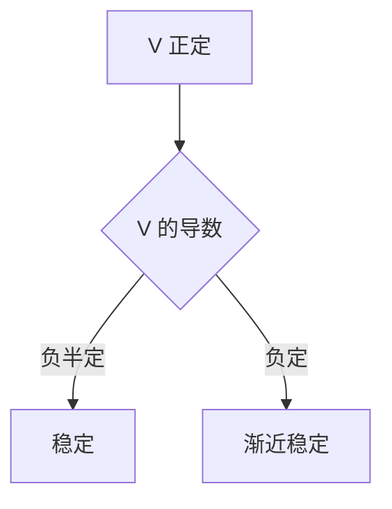

# 李雅普诺夫函数

- **难度**：高难 | **涉及章节**：第 8 章

## 一句话定义
正定且沿轨线导数负定（或负半定）的标量函数，用于判稳而不必解方程。

## 为什么重要
它绕开了"求特征值"和"解方程"两条路，直接靠"能量在减少"下结论。是非线性稳定性分析的主力工具。

## 图示

## 详解
V 的等值面像"等高线"，轨线只能往下走，所以出不了谷。若谷底唯一，最终停在谷底。

构造没有通用算法。常用：二次型、物理能量、平方和（SOS）。

## 常见误解
- 别以为 V 必须是能量。
- 别以为负半定能给渐近稳定（可能停在非零集上）。
- 别以为找不到 V 就不稳定。

## 在书中出现的脉络
| 章节 | 语境 | 关键结论 |
|---|---|---|
| 第 8 章 | 稳定性 | 第二方法 |

## 相关概念
- 前置：正定函数
- 后续：拉萨尔不变原理
