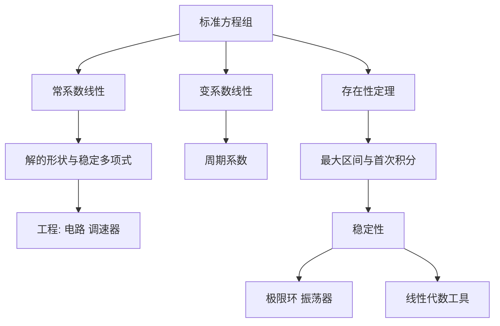

# 《常微分方程》（庞特里亚金）点化学习系统

## 这本书在讲什么
这是庞特里亚金在莫斯科大学讲义基础上写的书，最鲜明的特点是"数学与工程并重"：常系数方程一路讲到 RLC 电路、离心调速器、电子管振荡器；稳定多项式、复振幅法、相平面这些工具都是为工程问题准备的。理论部分（存在性证明、稳定性）放在后半，但写得极为紧凑。

## 全书心智模型

## 学习路径（推荐顺序）
| 步骤 | 章节 | 主题 | 前置 | 检查点 |
|---|---|---|---|---|
| 01 | ch01 | 引论：标准化 | 微积分 | 能把三阶方程化为方程组 |
| 02 | ch02 | 常系数线性（上）：根与解 | ch01 | 写出重根解 |
| 03 | ch02 | 常系数线性（下）：稳定多项式与工程 | ch02 | 用赫尔维茨判二阶 |
| 04 | ch03 | 变系数与周期系数 | ch02 | 写出单值矩阵 |
| 05 | ch04 | 存在性定理证明 | ch01 | 三种出口 |
| 06 | ch05 | 稳定性与极限环 | ch04 | 解释振荡器 |
| 07 | ch06 | 线性代数工具 | 线性代数 | 算 e^(At) |

## 章节索引
- 第 1 章 引论（★★☆）→ chapters/ch01-引论.md
- 第 2 章 常系数线性方程（★★★）→ chapters/ch02-常系数线性方程.md
- 第 3 章 变系数线性方程（★★★）→ chapters/ch03-变系数线性方程.md
- 第 4 章 存在性定理（★★★）→ chapters/ch04-存在性定理.md
- 第 5 章 稳定性（★★★）→ chapters/ch05-稳定性.md
- 第 6 章 线性代数（★★☆）→ chapters/ch06-线性代数.md

## 前置知识（零基础缺口补讲）
| 缺口 | 对应补讲位置 | 学完标志 |
|---|---|---|
| 复数与辐角 | ch02 2.4 | 能用复振幅法算相位 |
| 线性代数 | ch06 6.1 | 能算最小多项式 |
| 电路基础 | ch02 2.5 | 能写 RLC 方程 |

## 术语表 / 模式库 / 速查表 入口
- 术语：glossary.md
- 模式：patterns.md
- 速查：cheatsheet.md
- 测验：quiz.md
- 抽认卡：flashcards.md
