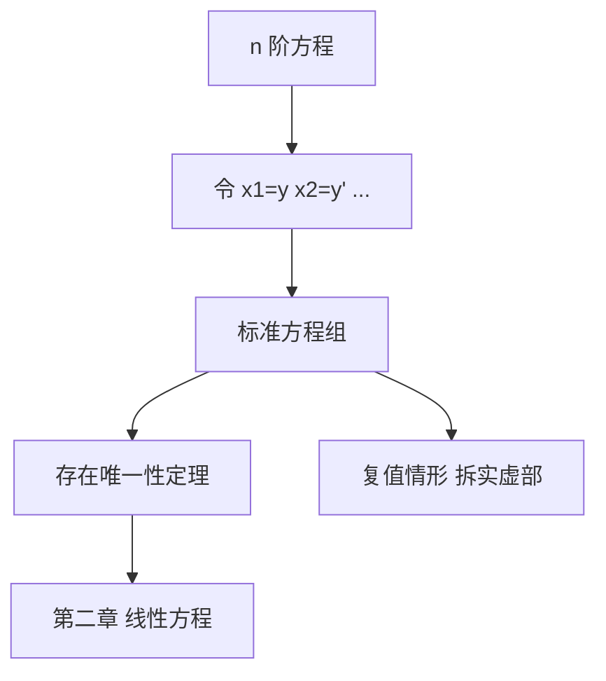

# 第 1 章：引论

- **难度**：★★☆ | **预估学时**：5 小时 | **前置**：微积分、复数初步
- **对应原书**：第一章（§1–§6）

## 学习目标
学完本章，你能：
1. 用"标准方程组"统一描述 n 阶方程与方程组；
2. 说明为什么庞特里亚金把存在唯一性"先叙述、后证明"；
3. 处理复值方程与实值方程的互化；
4. 说出线性方程在这本书里为何被提前到第二章。

## 一句话核心
第一章只做一件事：**把研究对象统一成"标准方程组"**。此后所有定理都只针对这一个对象陈述，包括复值情形。

## 零基础讲解

### 1.1 标准方程组

dx_i/dt = f_i(t, x₁, …, xₙ)，i=1,…,n

写成向量形式 ẋ=f(t,x)。n 阶方程通过令 x₁=y, x₂=y′,… 化为标准形。这一步是"标准化"，不是"简化"——它让所有定理只需证一次。

### 1.2 先叙述、后证明

庞特里亚金在第一章陈述存在唯一性定理，却把证明推到第四章。这个编排不是偷懒，而是教学策略：**先用定理把几何图像建立起来，再回头补证明**。你会在第二章反复使用定理来讨论线性方程，等用熟了，证明才有意义。

### 1.3 复值方程

若 f 取复值，可写成实部虚部两个实方程：

ż = f(t,z) ⇔ ẋ=Re f，ẏ=Im f（z=x+iy）

反过来，两个实方程常可合并成一个复方程，这在平面线性系统里特别有用（复特征值对应旋转）。

### 1.4 线性方程预览

本章最后一节给出线性方程的基本事实：解集是线性空间、齐次解可叠加。这些在第二章会被反复使用。

## 图示

看图说明：这张图的中心是"标准方程组"。左边是入口，右边是全书的走向。

## 类比与实例

**类比**：标准方程组像"统一货币"。不同国家的方程（高阶、方程组、复值）先换成同一种货币，才能用同一套定理结算。

**失效边界**：隐式方程 F(t,x,ẋ)=0 未必能解出 ẋ，此时无法标准化，需要隐函数定理的条件。

**实例**：y″+ω²y=0。令 x₁=y，x₂=y′，得 ẋ₁=x₂，ẋ₂=−ω²x₁。这是一个标准方程组，其解是 (cos ωt, −ω sin ωt) 的线性组合。

## 常见误解

- **别以为"标准化只是换记号"**——实际上它改变了定理的适用范围（从 n 阶到一阶向量）。
- **别以为"复方程是另一套理论"**——实际上它等价于两个实方程。
- **别以为"存在唯一性可以先用后证"**——实际上教材这么做是有意的教学顺序，自学时要知道证明在后面。

## 自测题（答案）

1. 三阶方程 y‴=f(t,y,y′,y″) 的标准形是什么？
   （答案：ẋ₁=x₂，ẋ₂=x₃，ẋ₃=f(t,x₁,x₂,x₃)。解析：逐级引入低阶导数。）

2. 复方程 ż=iz 对应的实方程组？
   （答案：ẋ=−y，ẏ=x。解析：iz=i(x+iy)=−y+ix。）

3. 为什么第一章先叙述定理后证明？
   （答案：先用几何图像建立直觉，证明放在第四章。解析：教学顺序的安排。）

4. 隐式方程何时不能标准化？
   （答案：无法解出最高阶导数时。解析：需要隐函数定理的非退化条件。）

## 复习锚点
- 一切化为标准方程组 ẋ=f(t,x)。
- 复方程 = 两个实方程。
- 定理先叙述，证明在第四章。
