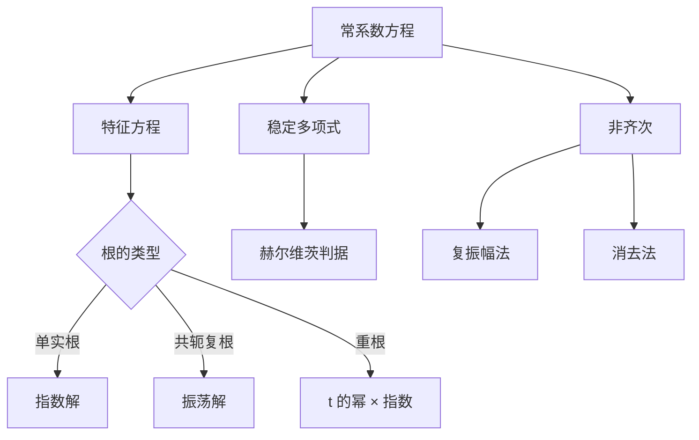

# 第 2 章：常系数线性方程

- **难度**：★★★ | **预估学时**：12 小时 | **前置**：第 1 章、线性代数
- **对应原书**：第二章（§7–§16）

## 学习目标
学完本章，你能：
1. 按单根、重根两种情形写出常系数齐次方程的通解；
2. 用赫尔维茨判据（稳定多项式）判断所有根是否具有负实部；
3. 用消去法把方程组化为一元高阶方程；
4. 用复数振幅法求正弦激励下的稳态解；
5. 建立 RLC 电路与线性系统的对应；
6. 在相平面上画出常系数线性系统的轨线。

## 一句话核心
庞特里亚金这一章的重心不在"怎么解"，而在"解的形状意味着什么"：**特征根决定振动还是发散，稳定多项式决定系统会不会炸，相平面决定轨线怎么排。**

## 零基础讲解

### 2.1 单根与重根

特征方程 λⁿ+a₁λⁿ⁻¹+…+aₙ=0。

**单根**：每个 λᵢ 贡献 e^(λᵢt)。实根给指数，复根成对给 e^(αt)cos βt、e^(αt)sin βt。

**重根**：k 重根 λ 贡献 e^(λt)、t e^(λt)、…、t^(k−1)e^(λt)。这是"共振"的代数来源：重根意味着方程对激励的响应里出现时间幂。

### 2.2 稳定多项式

一个实系数多项式若所有根的实部为负，称**稳定多项式**（赫尔维茨意义下）。

**赫尔维茨判据**：把系数排成赫尔维茨矩阵，所有顺序主子式为正 ⇔ 稳定。

对二阶 λ²+aλ+b：稳定 ⇔ a>0 且 b>0。对三阶 λ³+aλ²+bλ+c：稳定 ⇔ a>0、c>0、ab>c。

**为什么工程上关心这个**：不必解方程，只看系数符号与一个不等式，就能判断系统是否稳定。这是控制理论的入门工具。

### 2.3 非齐次与消去法

非齐次用待定系数（右端为多项式、指数、正弦的组合）或常数变易。

**消去法**：把方程组逐个求导、消元，化为一元高阶方程。代价是引入"多余解"（消去过程中产生的假根），必须回代检验。

### 2.4 复数振幅法

对 ẋ=Ax+b e^(iωt)，设特解 x=u e^(iωt)，代入得

(A−iωI)u = −b ⇒ u=−(A−iωI)⁻¹b

取实部即得实激励下的稳态解。这个方法把"三角函数的相位计算"变成了"复数矩阵求逆"。

### 2.5 电路与调速器

RLC 串联电路：L q̈+R q̇+q/C=E(t)，与弹簧-质量-阻尼系统完全同构。庞特里亚金用这个例子说明"不同物理系统可以有同一个方程"。

离心调速器（§27 提前出现）则是"稳定性决定机器能不能用"的经典案例。

### 2.6 相平面

对二阶常系数系统，用 p=tr A、q=det A 分类：结点、鞍点、焦点、中心。这一节是第三章定性理论的预热。

## 图示

看图说明：左边三支是"解的形状"，右边两支是"不解方程也能得到的结论"。工程上常用右边。

## 类比与实例

**类比**：特征根像"系统的性格"——负实根是"冷静收敛"，正实根是"越吵越凶"，纯虚根是"永远摇摆"。重根则是"性格里带惯性"，会多出一段越走越远的过程。

**失效边界**：这套分类只对常系数线性系统成立；变系数、非线性都要另想办法。

**实例**：L q̈+R q̇+q/C=E₀cos ωt。设复数激励 E₀e^(iωt)，解 u=E₀/(−Lω²+iRω+1/C)。取模得振幅，取辐角得相位差。当 ω=1/√(LC) 时振幅最大——这就是谐振。

## 常见误解

- **别以为"特征根都是负实部就一定稳定"**——对线性系统成立，对非线性只是局部结论。
- **别以为"重根一定意味着不稳定"**——负实部重根仍稳定，只是有 t 的幂。
- **别以为"消去法没有代价"**——会引入假解，必须回代。
- **别以为"复振幅法只对电路有效"**——对任何线性系统都有效。

## 自测题（答案）

1. λ=−1 是三重根，齐次解里出现哪些项？
   （答案：e^(−t)、t e^(−t)、t² e^(−t)。解析：重根给 t 的幂。）

2. 二阶方程 λ²+aλ+b 稳定的条件？
   （答案：a>0 且 b>0。解析：赫尔维茨判据的最简形式。）

3. 消去法为什么要回代？
   （答案：消元过程可能引入不满足原方程的解。解析：求导会丢失信息。）

4. 复振幅法的核心一步？
   （答案：设 x=u e^(iωt)，解 (A−iωI)u=−b。解析：把微分方程化为代数方程。）

## 复习锚点
- 单根写指数，重根加 t 的幂，复根写振荡。
- 稳定多项式看赫尔维茨判据。
- 相平面用 p、q 分类。
