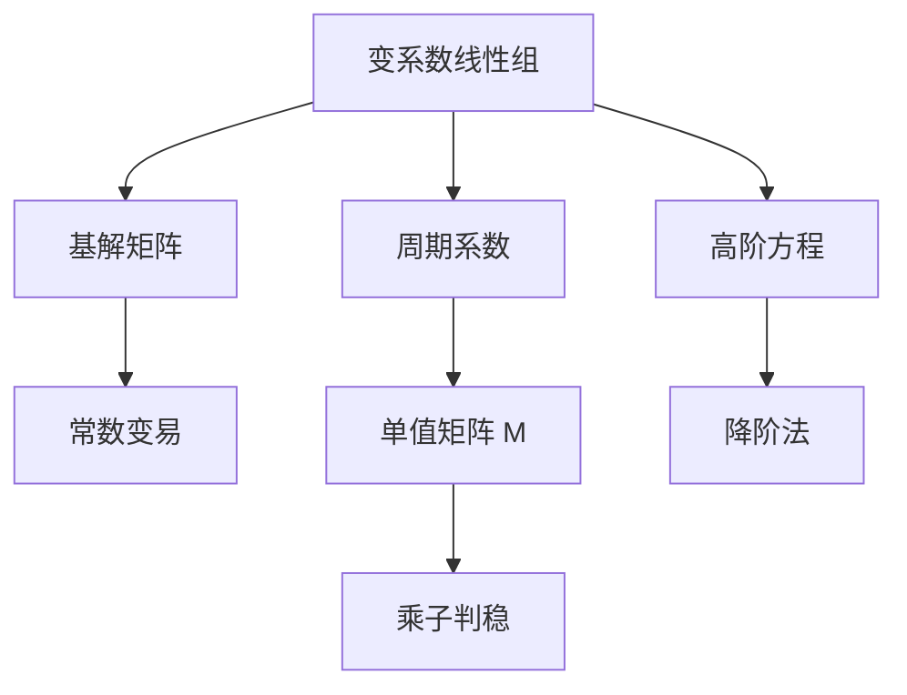

# 第 3 章：变系数线性方程

- **难度**：★★★ | **预估学时**：9 小时 | **前置**：第 2 章
- **对应原书**：第三章（§17–§19）

## 学习目标
学完本章，你能：
1. 写出标准线性方程组的一般理论（基解矩阵、常数变易）；
2. 把 n 阶变系数方程纳入方程组框架；
3. 处理周期系数系统，写出单值矩阵与稳定性判据；
4. 说明"变系数时没有特征值可用"这一根本困难。

## 一句话核心
变系数系统失去了"特征值"这个工具，只剩下两条路：**基解矩阵**（一般理论）与**单值矩阵**（周期情形）。

## 零基础讲解

### 3.1 标准线性方程组

ẋ = A(t)x + b(t)

A(t) 连续。解集 m 维，基解矩阵 Φ(t) 满足 Φ̇=AΦ，det Φ≠0（刘维尔公式）。

非齐次：

x = Φ(t)[C + ∫Φ⁻¹(s)b(s)ds]

### 3.2 n 阶变系数方程

y⁽ⁿ⁾+a₁(t)y⁽ⁿ⁻¹⁾+…+aₙ(t)y=b(t) 化为方程组。降阶法：已知一个特解 y₁，令 y=u y₁ 可降一阶（刘维尔-达朗贝尔降阶）。

### 3.3 周期系数

A(t+T)=A(t)。此时 Φ(t+T)=Φ(t)M，M 是单值矩阵。判稳看 M 的特征值（乘子）模。

**为什么这很重要**：变系数系统没有固定特征值，"稳定性"必须另找判据。周期情形下，单值矩阵提供了这个判据。

### 3.4 与常系数的对照

| 项目 | 常系数 | 变系数 |
|---|---|---|
| 基解矩阵 | e^(At) | 一般无显式 |
| 判稳工具 | 特征值 | 无（周期时有乘子） |
| 解的构造 | 待定系数 | 常数变易 |

这张表是本章的"痛点地图"：中间那一行说明了为什么变系数理论比常系数难得多。

## 图示

看图说明：左支是一般理论（存在但不显式），右支是周期情形（可算），下方是降阶技巧。

## 类比与实例

**类比**：常系数系统像"匀速行驶的车"，特征值就是速度；变系数系统像"油门一直在变的 车"，没有恒定速度，"稳不稳"要靠别的方式判。

**失效边界**：非周期变系数系统，乘子也无定义，稳定性只能靠李雅普诺夫函数或数值方法。

**实例**：A(t)=[[0,1],[−1,0]] 是常系数（也周期），M=Φ(2π)=I，乘子为 1，属临界。若改为 A(t)=[[0,1],[−1−ε cos t,0]]，参数 ε 跨过临界值时出现参数共振，乘子穿出单位圆。

## 常见误解

- **别以为"变系数也能算特征值"**——实际上 A(t) 随 t 变，特征值没有固定含义。
- **别以为"周期系统的稳定性靠平均矩阵"**——平均化只在特定条件下有效。
- **别以为"刘维尔公式只给行列式"**——它同时保证基解矩阵始终非奇异。

## 自测题（答案）

1. 刘维尔公式在变系数情形的形式？
   （答案：det Φ(t)=det Φ(t₀)exp(∫tr A ds)。解析：与常系数相同形式。）

2. 周期系数系统的判稳工具？
   （答案：单值矩阵的乘子。解析：Φ(t+T)=Φ(t)M。）

3. 降阶法需要什么前提？
   （答案：已知一个非零特解。解析：y=u y₁ 代入后可降一阶。）

4. 变系数系统为什么难？
   （答案：没有固定特征值可算。解析：A(t) 随 t 变。）

## 复习锚点
- 基解矩阵 + 常数变易是一般理论。
- 周期情形用单值矩阵。
- 变系数没有特征值可用。
