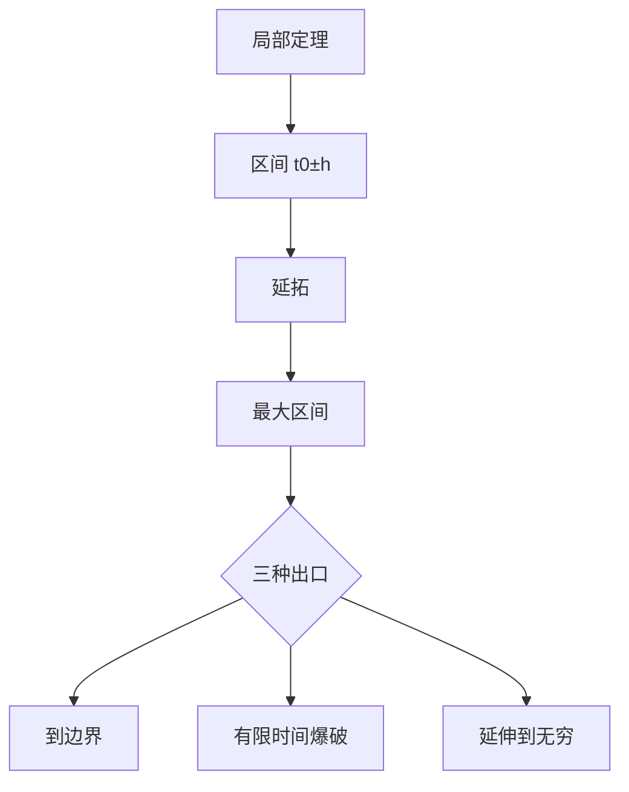

# 第 4 章：存在性定理

- **难度**：★★★ | **预估学时**：9 小时 | **前置**：第 1、3 章
- **对应原书**：第四章（§20–§25）

## 学习目标
学完本章，你能：
1. 完整证明一个方程与方程组的存在唯一性定理；
2. 证明解对初值的连续性与可微性（局部定理）；
3. 说明首次积分与轨线维数的关系；
4. 描述轨线在最大时间区间上的行为（三种出口）；
5. 区分局部定理与整体定理的假设差别。

## 一句话核心
这一章把第一章"先叙述"的定理全部补上证明，并且多做一件事：**把局部结论推到最大区间上**。庞特里亚金的写法特别强调"轨线跑到哪里去了"。

## 零基础讲解

### 4.1 一个方程的证明

先对 n=1 证，再推广到方程组。步骤与皮卡一致：积分方程 → 迭代 → 估计 → 收敛 + 唯一。

**为什么先证一个方程**：记号简单，几何直观，且推广到方程组只是把绝对值换成范数。

### 4.2 局部连续性与可微性

解对初值连续依赖：两解作差 + 格朗沃尔。
解对初值可微：变分方程 Φ′=f_xΦ，Φ(t₀)=I。

**局部定理的条件**：f 在某个邻域内连续（及对 x 连续可微）。结论只在这个邻域对应的区间上成立。

### 4.3 首次积分

F 沿轨线为常数 ⇔ X·∇F=0。n 维系统独立首次积分有 n−1 个。

### 4.4 最大时间区间上的行为

轨线只有三种结局：
1. 跑到定义域边界；
2. 在有限时间内爆破（|x|→∞）；
3. 定义到 ±∞。

**这条结论的用处**：判断"解能不能一直活下去"，是稳定性讨论的前置问题。

### 4.5 整体定理

若 f 在整个区域内连续（且对 x 连续可微），且解在某个紧集内不逸出，则可微性在最大区间上整体成立。

**局部 vs 整体的差别**：局部定理只保证"在某段区间上"，整体定理要额外假设"解不逸出紧集"。

## 图示

看图说明：这张图的核心是"出口"——很多证明题问"解能否延伸到无穷"，答案就在这三个分支里。

## 类比与实例

**类比**：最大区间像"一条路的全程"。局部定理只保证"能走 h 米"，整体定理告诉你能不能走完，出口分析告诉你路在哪里断。

**失效边界**：如果 f 在区域内不连续，出口分析失效，可能出现"解在有限时间跳到另一支"的怪现象。

**实例**：ẋ=x²，x(0)=1。解 x=1/(1−t)，在 t=1 爆破，最大区间是 (−∞,1)。这是第二种出口。

## 常见误解

- **别以为"局部解能一直延拓"**——实际上可能爆破。
- **别以为"爆破就是解不存在"**——实际上解在爆破前存在，只是区间有限。
- **别以为"整体定理与局部定理只差区间"**——整体定理要多假设不逸出。

## 自测题（答案）

1. 最大区间的三种出口？
   （答案：到边界、有限时间爆破、延伸到无穷。解析：见 §24。）

2. ẋ=x²，x(0)=1 的最大区间？
   （答案：(−∞,1)。解析：解为 1/(1−t)，t=1 爆破。）

3. 整体可微定理比局部定理多什么假设？
   （答案：解不逸出紧集（或 f 在整体区域满足条件）。解析：否则无法控制。）

4. 首次积分与轨线维数的关系？
   （答案：n−1 个独立首次积分把轨线定成一维。解析：维数计数。）

## 复习锚点
- 证明四步 + 格朗沃尔。
- 首次积分有 n−1 个。
- 最大区间三种出口。
