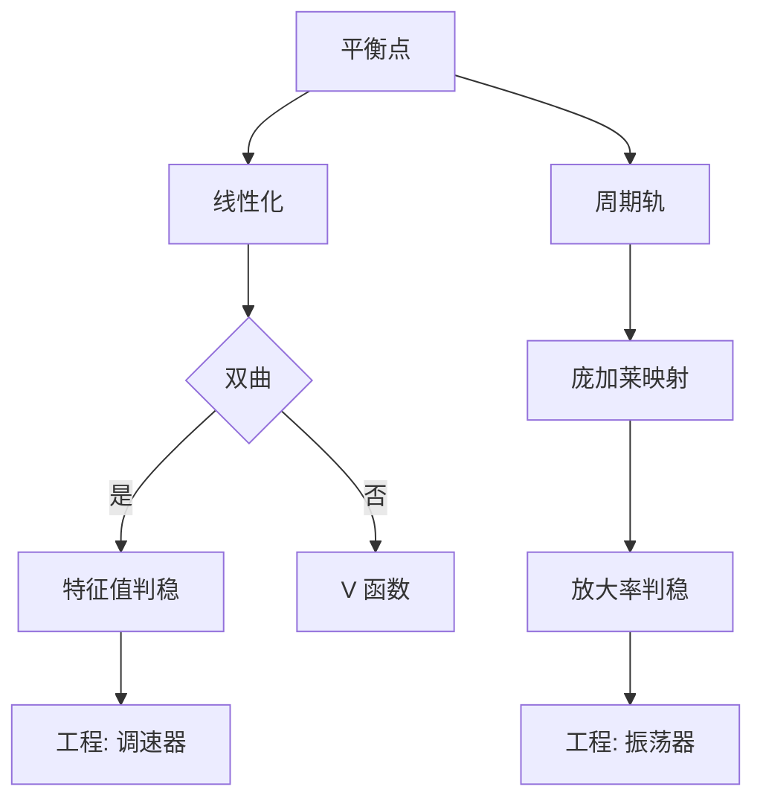

# 第 5 章：稳定性

- **难度**：★★★ | **预估学时**：10 小时 | **前置**：第 2、4 章
- **对应原书**：第五章（§26–§31）

## 学习目标
学完本章，你能：
1. 陈述并证明李雅普诺夫稳定性定理与渐近稳定性定理；
2. 用离心调速器说明"稳定性是工程可用性的前提"；
3. 说明极限环的存在与稳定性判据；
4. 用电子管振荡器解释"自激振荡"的数学机制；
5. 分析二阶自治系统平衡位置的类型；
6. 讨论周期解的稳定性。

## 一句话核心
庞特里亚金把稳定性写成"工程问题的数学化"：**调速器会飞车、电子管会起振，都是因为平衡点或周期轨的稳定性发生了变化**。

## 零基础讲解

### 5.1 李雅普诺夫定理

**稳定性**：∀ε>0，∃δ>0，初值在 δ 内则轨线永远在 ε 内。
**渐近稳定**：稳定且 t→∞ 时趋于平衡点。

**定理（第一方法）**：A=f′(0)，特征值实部全负 ⇒ 渐近稳定。
**定理（第二方法）**：V 正定、V̇ 负半定 ⇒ 稳定；V̇ 负定 ⇒ 渐近稳定。

### 5.2 离心调速器

瓦特调速器的方程是一个二阶非线性系统。平衡点对应"转速稳定"。若平衡点不稳定，转速会持续上升或振荡——机器就废了。

庞特里亚金用这个例子说明：**稳定性不是数学游戏，是"这台机器能不能用"**。

### 5.3 极限环

极限环是孤立的闭轨。存在判据在平面用庞加莱-本迪克松；稳定性用庞加莱映射的导数。

**极限环的工程意义**：它对应"自激振荡"——系统不需要外部周期激励，自己就会周期运动。

### 5.4 电子管振荡器

电子管电路的非线性特性使平衡点失稳，轨线被吸引到一个极限环上，于是产生稳定振幅的振荡。这就是"振荡器"的数学解释。

### 5.5 二阶自治系统与周期解稳定性

二阶自治系统的平衡位置用 p、q 分类。周期解的稳定性用"绕一圈的放大率"判断：放大率小于 1 则稳定。

## 图示

看图说明：左边是"点"的稳定性，右边是"圈"的稳定性；两侧各挂一个工程实例，这是本书的特色。

## 类比与实例

**类比**：极限环像"跑道"。不管运动员从哪里出发，最后都会跑上同一条跑道，以固定节奏绕圈——这就是振荡器的稳定振荡。

**失效边界**：三维以上没有庞加莱-本迪克松，闭轨存在性无简单判据。

**实例**：范德波尔方程 x″+ε(x²−1)x′+x=0（ε>0）。原点不稳定（线性化特征值实部为正），但存在唯一稳定极限环，所有非零轨线都趋近它。这就是电子管振荡器的模型。

## 常见误解

- **别以为"稳定就是不动"**——实际上稳定是"不跑远"，可以振荡。
- **别以为"极限环一定稳定"**——实际上有稳定环也有不稳定环。
- **别以为"线性化判稳对所有系统有效"**——实际上非双曲时失效。

## 自测题（答案）

1. 第二方法判渐近稳定的条件？
   （答案：V 正定且 V̇ 负定。解析：负半定只能给稳定。）

2. 极限环的工程意义？
   （答案：自激振荡，无需外部周期激励。解析：轨线被吸引到闭轨。）

3. 周期解稳定性的判据？
   （答案：庞加莱映射导数的绝对值小于 1。解析：绕一圈的放大率小于 1。）

4. 调速器不稳定的后果？
   （答案：转速失控或持续振荡。解析：平衡点失稳。）

## 复习锚点
- 线性化判稳 + V 函数补刀。
- 极限环 = 自激振荡。
- 周期解稳定性看庞加莱映射。
