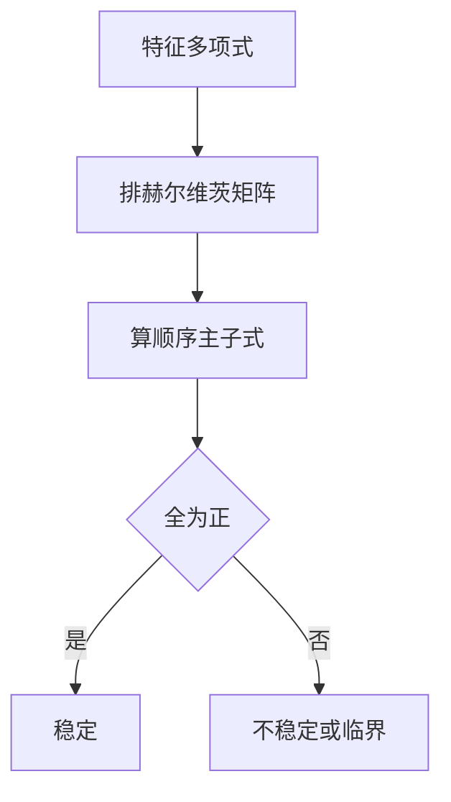

# 稳定多项式（赫尔维茨判据）

- **难度**：进阶 | **涉及章节**：第 2 章

## 一句话定义
所有根的实部都为负的实系数多项式；判据是赫尔维茨矩阵的顺序主子式全为正。

## 为什么重要
它让"系统是否稳定"变成"看系数"，不必解方程。这是控制理论的第一课。

## 图示

## 详解
二阶：λ²+aλ+b，稳定 ⇔ a>0、b>0。
三阶：λ³+aλ²+bλ+c，稳定 ⇔ a>0、c>0、ab>c。
三阶那个不等式最关键：a、b、c 都正还不够，还要 ab>c，否则有一对共轭复根跑到右半平面。

## 常见误解
- 别以为"系数全正就稳定"（三阶反例）。
- 别以为判据对非线性系统有效（只对线性）。
- 别以为"临界"等于"稳定"。

## 在书中出现的脉络
| 章节 | 语境 | 关键结论 |
|---|---|---|
| 第 2 章 | §9 稳定多项式 | 赫尔维茨判据 |
| 第 5 章 | 稳定性 | 线性化后用它 |

## 相关概念
- 前置：特征方程
- 后续：劳斯判据、李雅普诺夫
