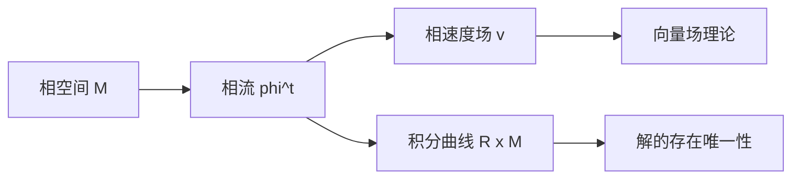

# 第 1 章：相空间与相流

- **难度**：★★☆ | **预估学时**：5 小时 | **前置**：微积分、微分流形初步
- **对应原书**：第一章（§1–§6）

## 学习目标
学完本章，你能：
1. 用"确定、有限维、可微"三个词刻画一个动力系统；
2. 说清相流、相速度场、积分曲线三个对象的关系；
3. 说明单摆的相空间为什么取柱面而不是平面；
4. 解释"相流是单参数微分同胚群"这句话。

## 一句话核心
阿诺尔德不从"方程"出发，而从"过程"出发：**一个有确定未来的过程，其状态空间上自动长出一个流**。方程只是这个流的无穷小描述。

## 零基础讲解

### 1.1 三个限定词

- **确定**：现在决定未来（也决定过去）。
- **有限维**：状态由有限个参数描述。流体、弦振动不行。
- **可微**：状态随时间的变化是光滑的。

这三条合起来，就是常微分方程的研究对象。热传导是"半确定"（只决定未来不决定过去），量子力学不确定——这些都在本课程之外。

### 1.2 相空间与相流

**相空间 M**：所有可能状态的集合。
**相流**：映射 φᵗ:M→M，把"状态"送到"t 时间后的状态"。它满足群性质：

φ⁰=id，φ^(s+t)=φˢ∘φᵗ

**相速度场**：v(x)=d/dt φᵗ(x)|ₜ₌₀。这是 M 上的向量场。

**积分曲线**：扩张相空间 R×M 中的曲线 t↦(t, φᵗ(x))。它总是横截时间轴——**在扩张相空间里，积分曲线永不相交**。

### 1.3 单摆为什么在柱面上

单摆状态是（角度，角速度）。角度加 2π 是同一个物理状态，所以状态空间是柱面 S¹×R，不是平面。

**这个细节是阿诺尔德的标志**：他反复强调"相空间的选择由物理决定，不是由方程决定"。选错空间，会把闭合轨线误判成不闭合。

### 1.4 微分同胚

相流 φᵗ 对每个固定的 t 是微分同胚（可微、可逆、逆也可微）。这是"确定性"的几何表述：过程可逆，不会丢信息。

## 图示

看图说明：上面是"流的观点"，下面是"方程的观点"。两者等价，但前者先给出几何图像。

## 类比与实例

**类比**：相流像"河流的流线"。每个水滴（状态）沿流线走，流线不相交——这正是确定性的几何含义。

**失效边界**：在平衡点处流线退化成一个点，方向无意义。

**实例**：谐振子 ẋ=y，ẏ=−x。相流是旋转：φᵗ(x,y)=(x cos t+y sin t, −x sin t+y cos t)。相速度场 v=(y,−x)，轨线是圆。

## 常见误解

- **别以为"相空间就是 Rⁿ"**——实际上由物理约束决定（角度 mod 2π、能量面等）。
- **别以为"积分曲线与轨线是同一个"**——实际上前者在 R×M，后者在 M。
- **别以为"相流可逆是废话"**——实际上它排除了耗散型"多对一"的过程。

## 自测题（答案）

1. 动力系统的三个限定词？
   （答案：确定、有限维、可微。解析：见 §1.1。）

2. 单摆的相空间为什么是柱面？
   （答案：角度 mod 2π 是同一状态。解析：柱面把两端粘合。）

3. 相流满足什么群性质？
   （答案：φ⁰=id，φ^(s+t)=φˢ∘φᵗ。解析：单参数群。）

4. 扩张相空间中积分曲线会相交吗？
   （答案：不会。解析：每条曲线在 t 方向的斜率为 1。）

## 复习锚点
- 确定 + 有限维 + 可微 = 常微分方程的对象。
- 相流是单参数微分同胚群。
- 相速度场 = 流的无穷小生成元。
