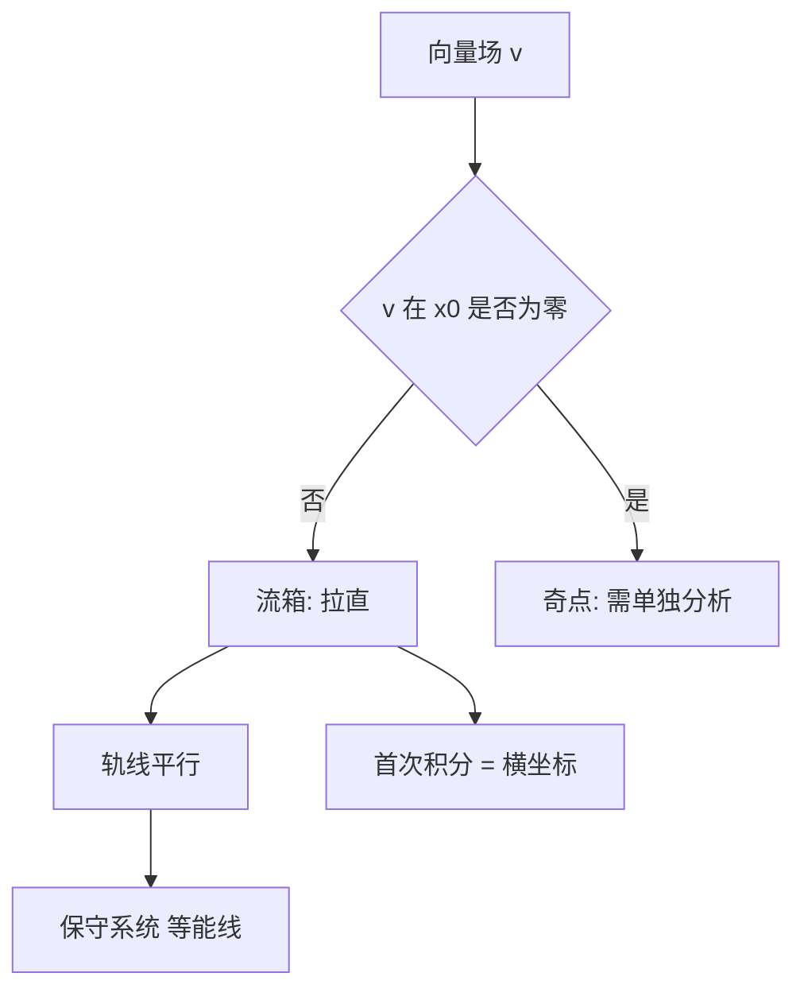

# 第 2 章：常点附近的向量场与首次积分

- **难度**：★★★ | **预估学时**：8 小时 | **前置**：第 1 章
- **对应原书**：第二章前半（§7–§12）

## 学习目标
学完本章，你能：
1. 用"流箱"（flow box）定理把常点附近的向量场拉直；
2. 说明非自治系统如何通过加一个时间坐标化为自治；
3. 在高阶方程中读出相曲线的几何意义；
4. 用方向导数定义首次积分；
5. 分析一个自由度的保守系统（能量面与相曲线）。

## 一句话核心
常点附近，向量场可以**局部拉直成平行场**。这一步看似技术，实则是全部定性理论的起点：拉直之后，轨线就是直线，首次积分就是"横坐标"。

## 零基础讲解

### 2.1 流箱定理

设 v(x₀)≠0。则存在坐标变换把 v 变成 ∂/∂x₁（即所有轨线平行于第一坐标轴）。

**证明思路**：取过 x₀ 且横截 v 的超平面，沿 v 的轨线用它做"标号"，再取沿轨线的时间做第一个坐标。

**用途**：任何局部问题都可以在这个坐标里算。这就是"局部定性理论"的全部秘密。

### 2.2 非自治化自治

ẋ=f(t,x) 可以通过令 x₀=t，ẋ₀=1 变成自治系统（维数 +1）。于是"非自治"不是新理论，只是"自治系统的一个特殊切片"。

阿诺尔德特别指出这一点，因为它把全书的理论统一了：**只需要研究自治系统**。

### 2.3 高阶方程的相曲线

y⁽ⁿ⁾=f(...) 化为方程组后，轨线在 Rⁿ 中。对二阶方程，相平面上的轨线就是"位移-速度"曲线，它丢掉了时间信息。

### 2.4 首次积分

**方向导数**：沿 v 的导数 L_v F=∇F·v。
**首次积分**：L_v F=0 且 ∇F≠0。

在流箱坐标里，F 就是"横截面的标号"，所以首次积分 = "你在哪条轨线上"。

### 2.5 保守系统

一个自由度的保守系统：H(p,q)=p²/2+V(q)。相曲线就是等能线 H=const。**这个结论不需要解方程**，直接由首次积分得到。

**为什么重要**：它是"定性方法优于定量方法"的典型例子——等能线的形状决定运动是振动、逃逸还是分界。

## 图示

看图说明：这张图是"局部 vs 奇点"的分水岭。右边那一支是第三章以后的内容。

## 类比与实例

**类比**：流箱像"把弯曲的河道改造成笔直的水渠"。改造只在局部有效，但足够你算清楚这一段的水流。

**失效边界**：流箱只在常点附近存在；奇点附近向量场为零，拉直失败。

**实例**：谐振子 H=p²/2+q²/2，等能线是圆。能量 E 决定半径 √(2E)，所以"能量守恒"直接给出"轨线是圆"。

## 常见误解

- **别以为"流箱只是换坐标"**——实际上它把"解方程"变成了"读坐标"。
- **别以为"非自治需要新理论"**——实际上加一维就化为自治。
- **别以为"首次积分一定存在"**——实际上奇点附近可能退化。

## 自测题（答案）

1. 流箱定理的条件？
   （答案：v(x₀)≠0。解析：常点处才能拉直。）

2. 非自治系统如何化为自治？
   （答案：令 x₀=t，ẋ₀=1，维数加一。解析：时间变成坐标。）

3. 保守系统的相曲线是什么？
   （答案：等能线 H=const。解析：H 是首次积分。）

4. 首次积分的定义式？
   （答案：∇F·v=0 且 ∇F≠0。解析：沿 v 方向导数为零。）

## 复习锚点
- 常点 ⇒ 流箱 ⇒ 轨线平行。
- 非自治 = 自治 + 一维时间。
- 保守系统：等能线即相曲线。
