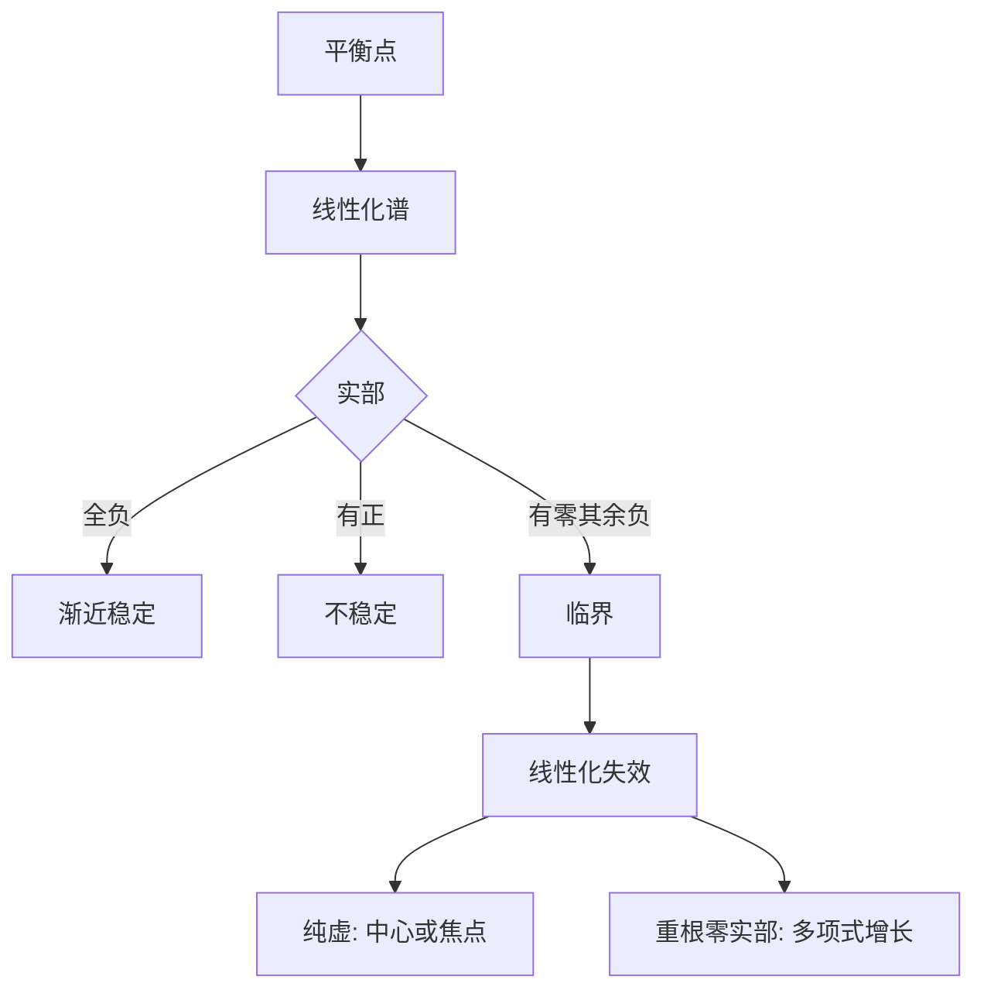

# 第 4 章：平衡位置的稳定性

- **难度**：★★★ | **预估学时**：9 小时 | **前置**：第 3 章
- **对应原书**：第二章中后段（§23–§27）

## 学习目标
学完本章，你能：
1. 按特征值分类平衡位置的稳定性（含纯虚、重根两种临界情形）；
2. 说明"线性化判稳"的边界：为什么纯虚情形不能下结论；
3. 用稳定多项式判据（赫尔维茨）快速判断；
4. 分析非自治线性方程的稳定性。

## 一句话核心
稳定性在阿诺尔德笔下是一个"谱问题"：**看特征值落在左半平面、右半平面，还是虚轴上**。前两者干脆利落，第三者才是全部困难的来源。

## 零基础讲解

### 4.1 三种情形

- **全部实部为负**：渐近稳定（线性化即可）。而且这个结论对非线性系统也成立（双曲情形）。
- **有实部为正**：不稳定（同样对非线性成立）。
- **全部实部 ≤0 且有实部为零**：**临界**，线性化失效。

### 4.2 纯虚情形

特征值 ±iω。线性系统是中心（稳定但不渐近）。但非线性扰动可能把它变成稳定焦点、不稳定焦点，或者仍是中心。

**这是全书最重要的警告**：临界情形下，"线性化"给不出任何结论，必须用李雅普诺夫函数或保守量。

例：ẍ+x+εx³=0。ε>0 时轨线是闭合的（保守量存在）；ẍ+x+εẋ=0 时是稳定焦点。两者线性化都是中心。

### 4.3 重特征值

若尔当块带来 t 的幂。实部为负时仍渐近稳定（t^k e^(−λt)→0），但趋近速度不是纯指数。实部为零且有若尔当块时，轨线多项式增长——不稳定。

### 4.4 稳定多项式

实系数多项式的所有根实部为负 ⇔ 赫尔维茨矩阵顺序主子式全正。这是"不解方程判稳"的代数工具（庞特里亚金那本讲得更细）。

### 4.5 非自治线性

ẋ=A(t)x。稳定性的判据不再由"特征值"给出（A(t) 没有固定谱）。特殊情形（A 为常数、A 周期）可以算；一般情形只能用李雅普诺夫函数或基本解矩阵的增长估计。

## 图示

看图说明：这张图的重点是底部两支。考试里"线性化失效"几乎总是意味着"要用别的方法"。

## 类比与实例

**类比**：临界情形像"天平恰好水平"。理论上不动，但一根羽毛就能决定它往哪边倒——线性化看不出羽毛的方向。

**失效边界**：如果系统的临界情形由守恒量保护（如哈密顿系统），那么它稳定；若被耗散项破坏，就失稳。

**实例**：线性中心 ẋ=y，ẏ=−x，轨线是圆，稳定。加扰动 ẏ=−x−εy（ε>0）变成稳定焦点，轨线螺旋趋近原点；ε<0 则不稳定焦点。三者线性化主部相同。

## 常见误解

- **别以为"实部非正就稳定"**——实际上零实部加若尔当块会多项式增长。
- **别以为"中心一定稳定"**——实际上非线性扰动可能让它失稳。
- **别以为"赫尔维茨判据只对二阶有用"**——实际上任意阶都能排矩阵。

## 自测题（答案）

1. 线性化能判稳的条件？
   （答案：特征值实部都不为零（双曲）。解析：否则临界。）

2. 纯虚情形为何不能下结论？
   （答案：非线性扰动可能改变稳定性类型。解析：中心、焦点都可能。）

3. 零实部加若尔当块会怎样？
   （答案：轨线多项式增长，不稳定。解析：t^k 因子。）

4. 赫尔维茨判据的结论形式？
   （答案：顺序主子式全正 ⇔ 所有根实部为负。解析：等价于稳定多项式。）

## 复习锚点
- 双曲：看实部符号。
- 临界：线性化失效，另找方法。
- 稳定多项式：看赫尔维茨矩阵。
