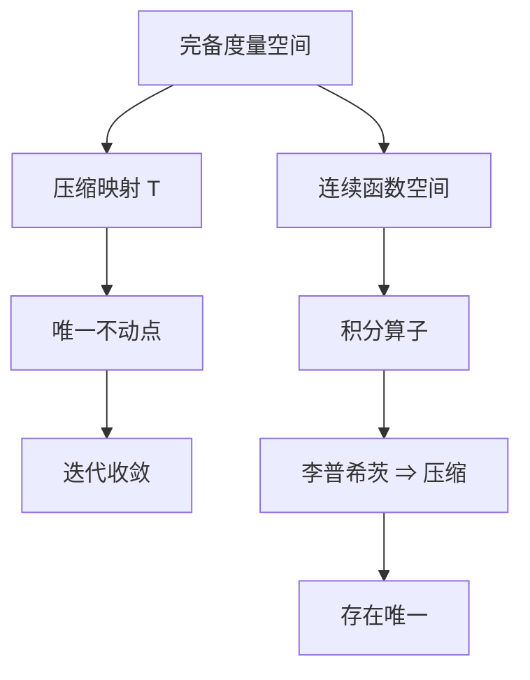

# 第 6 章：存在、唯一与可微性定理

- **难度**：★★★ | **预估学时**：8 小时 | **前置**：第 2、5 章
- **对应原书**：第二章（§30–§32）

## 学习目标
学完本章，你能：
1. 陈述并证明压缩映射原理（巴拿赫不动点定理）；
2. 用它证明存在唯一性定理，并说清"为什么这是最干净的一条路"；
3. 证明解对初值的可微性（可微性定理）；
4. 说明阿诺尔德为何把压缩映射放在证明之前。

## 一句话核心
阿诺尔德的证明路线与皮卡不同：**先用压缩映射原理证抽象的不动点存在唯一，再把积分方程塞进这个框架**。这样"存在唯一"变成一个纯度量空间的事实。

## 零基础讲解

### 6.1 压缩映射原理

设 X 是完备度量空间，T:X→X 满足 d(Tx,Ty)≤q d(x,y)（q<1）。则 T 有唯一不动点，且迭代 xₙ₊₁=Txₙ 收敛到它。

**证明两行**：迭代列是柯西列（因为 d(xₙ₊₁,xₙ)≤qⁿd(x₁,x₀) 可和），完备性给极限，压缩性给唯一。

### 6.2 用到积分方程

把初值问题写成

y = y₀ + ∫f(t,y)dt =: T(y)

在连续函数空间（上确界范数，完备）上，若 f 满足李普希茨，则 T 是压缩（压缩因子 Lh<1，取 h<1/L）。于是存在唯一。

**为什么这条路线干净**：它不需要逐项估计 φₙ 的收敛速度，也不需要证明"极限满足积分方程"——不动点定理已经包办。

### 6.3 可微性定理

解对初值可微，且 ∂y/∂y₀ 满足变分方程。证明思路：把"对初值求导"看成"在参数化的问题族上做差商"，再用压缩映射的一致收敛性取极限。

### 6.4 与皮卡路线的关系

皮卡迭代就是压缩映射迭代的特例（T 是积分算子）。阿诺尔德只是把"为什么收敛"这件事抽象出来，讲得更清楚。

## 图示

看图说明：上半是抽象定理，下半是具体应用。两者之间靠"李普希茨 ⇒ 压缩因子 Lh<1"连接。

## 类比与实例

**类比**：压缩映射像"不断对折一张纸"。每折一次距离减半，最终所有点聚到同一个位置——那就是不动点。

**失效边界**：如果 T 只是"非扩张"（q=1），不动点可能不存在（如平移映射 x↦x+1）。

**实例**：解 y′=y，y(0)=1。T(y)=1+∫₀ˣy dt。取 h<1，压缩因子 h<1。迭代从 y₀≡1 开始，得到部分和 1+x+x²/2+…，收敛到 eˣ。

## 常见误解

- **别以为"压缩映射只能证存在"**——实际上它同时给唯一性和迭代算法。
- **别以为"q<1 是技术条件"**——实际上 q=1 时结论不成立。
- **别以为"完备性可以省略"**——实际上柯西列未必收敛。

## 自测题（答案）

1. 压缩映射原理的三个条件？
   （答案：完备度量空间、压缩（q<1）、自映射。解析：缺一不可。）

2. 为什么取 h<1/L？
   （答案：使积分算子的压缩因子 Lh<1。解析：压缩映射要求严格小于 1。）

3. 阿诺尔德路线与皮卡路线的差别？
   （答案：前者先证抽象不动点定理再套用，后者直接迭代估计。解析：本质相同。）

4. 可微性定理的结论？
   （答案：∂y/∂y₀ 存在且满足变分方程。解析：Φ′=f_yΦ，Φ(x₀)=I。）

## 复习锚点
- 压缩映射：完备 + q<1 ⇒ 唯一不动点。
- 积分算子 + 李普希茨 ⇒ 压缩。
- 可微性 = 差商 + 一致收敛。
