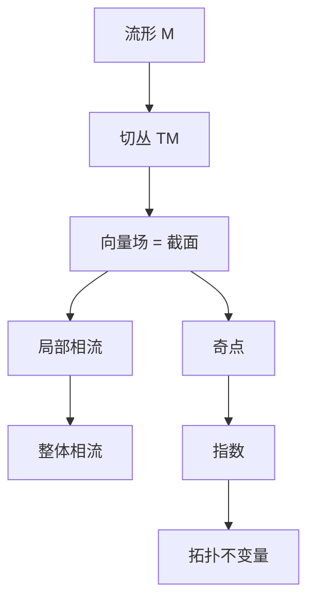

# 第 7 章：流形、切丛与奇点指数

- **难度**：★★★ | **预估学时**：7 小时 | **前置**：第 1、3 章、拓扑初步
- **对应原书**：第二章末段（§33–§36）

## 学习目标
学完本章，你能：
1. 说明为什么相空间必须是微分流形（单摆的柱面、刚体的 SO(3)）；
2. 用切丛语言重述"向量场"；
3. 由向量场构造相流（局部单参数群）；
4. 定义向量场奇点的指数并计算简单情形。

## 一句话核心
这一章把前面所有内容"搬"到流形上：**向量场不再是 Rⁿ 上的箭头，而是切丛的一个截面；奇点指数则是一个拓扑不变量**。

## 零基础讲解

### 7.1 为什么需要流形

单摆的相空间是柱面（角度 mod 2π）；刚体姿态空间是 SO(3)；能量面常常是球面或环面。

在这些空间里，"坐标"只能局部取，但"向量场""轨线"仍然有意义。这就是流形的用处：**它允许你在没有全局坐标的地方做微分**。

### 7.2 切丛与向量场

切空间 T_xM 是 x 处所有切向量。切丛 TM=∪T_xM。向量场是映射 v:M→TM，且 v(x)∈T_xM（称为截面）。

**为什么这个说法重要**：它保证"向量场与空间是同一个对象的两面"，不会出现"箭头指向空间外"的错误。

### 7.3 由向量场构造相流

解的存在唯一性定理在流形上仍成立（局部）。把所有局部流拼起来，得到整体流（在紧流形上总能拼完）。

### 7.4 奇点指数

对平面向量场，孤立奇点 x₀ 的指数：取包围 x₀ 的小圆圈，沿圈走一圈，向量场方向转过的总圈数。

**性质**：
- 结点、焦点、中心：指数 +1；
- 鞍点：指数 −1；
- 指数是可加的（区域内有多个奇点时，总指数等于边界曲线的绕数）。

**用途**：由指数可以判断"奇点的总数与类型"，不必逐个分析。例如球面上的向量场总指数为 2（毛球定理）。

## 图示

看图说明：左边是"几何对象"，右边是"拓扑结论"。指数之所以重要，是因为它不随连续变形改变。

## 类比与实例

**类比**：奇点指数像"梳头时 unavoidable 的旋"。你没法把球面上的毛全部梳平——总得有几个旋，旋的"类型"就是指数。

**失效边界**：指数只对孤立奇点定义；奇点连成一条线时，指数无定义。

**实例**：平面向量场 v=(x,y)（结点），绕单位圆一圈，方向从 (1,0) 转到 (0,1) 再转回，共转 1 圈，指数 +1。
v=(x,−y)（鞍点），绕圈时方向变化的净绕数为 −1，指数 −1。

## 常见误解

- **别以为"流形只是高维曲面"**——实际上关键在于"局部有坐标、整体未必有"。
- **别以为"指数是连续量"**——实际上它是整数，做连续变形不变。
- **别以为"指数能决定稳定性"**——实际上指数 +1 的奇点可能是稳定也可能不稳定。

## 自测题（答案）

1. 单摆的相空间是什么流形？
   （答案：柱面 S¹×R。解析：角度 mod 2π。）

2. 向量场在流形上的严格定义？
   （答案：TM 的截面，v(x)∈T_xM。解析：保证向量在切空间内。）

3. 鞍点的指数？
   （答案：−1。解析：绕圈方向净转数为负。）

4. 球面上向量场总指数为什么是 2？
   （答案：欧拉示性数决定（毛球定理）。解析：拓扑不变量。）

## 复习锚点
- 相空间是流形，向量场是切丛截面。
- 指数：结点/焦点/中心 +1，鞍点 −1。
- 指数是拓扑不变量。
