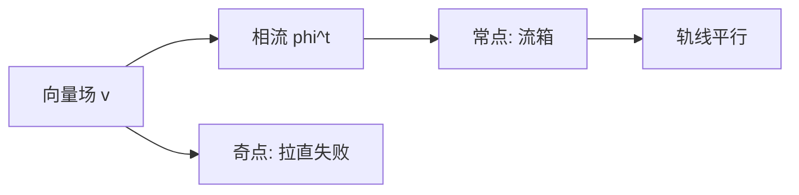

# 相流与流箱

- **难度**：进阶 | **涉及章节**：第 1、2 章

## 一句话定义
相流是状态空间上的单参数变换群 φᵗ；流箱是常点附近把它拉直成平行移动的局部坐标。

## 为什么重要
它把"解方程"变成"读坐标"，是全部局部定性理论的技术核心。

## 图示

## 详解
流箱的做法：取横截超平面做标号，沿轨线的时间做第一坐标。在这个坐标里，向量场就是 ∂/∂x₁，轨线是平行直线，首次积分就是横坐标。

## 常见误解
- 别以为流箱是全局的（只在常点邻域）。
- 别以为拉直改变了动力学（只是换坐标）。
- 别以为奇点也能拉直（v=0 处无方向）。

## 在书中出现的脉络
| 章节 | 语境 | 关键结论 |
|---|---|---|
| 第 1 章 | 相流定义 | 单参数群 |
| 第 2 章 | 常点 | 流箱定理 |

## 相关概念
- 前置：向量场
- 后续：首次积分、局部标准形
