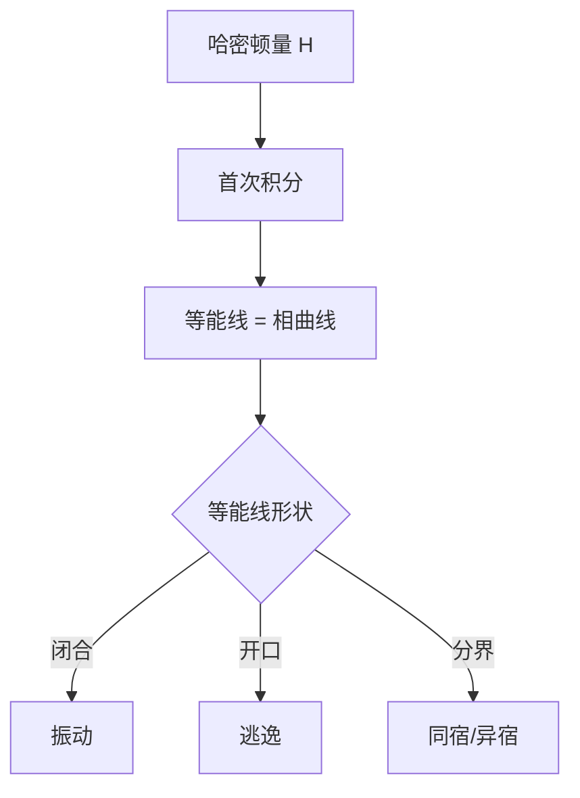

# 首次积分与保守系统

- **难度**：进阶 | **涉及章节**：第 2 章

## 一句话定义
沿轨线取常数的光滑函数；保守系统的能量就是最典型的首次积分。

## 为什么重要
它让你不接方程就能画出相图：等能线的形状决定运动类型。

## 图示

## 详解
对 H=p²/2+V(q)，相曲线就是 H 的等值线。势阱内的闭合等能线对应周期振动；能量超过势垒则开口，对应逃逸。

分界线（连接鞍点的轨线）把两类运动分开，它的周期趋于无穷。

## 常见误解
- 别以为首次积分一定是能量（也可以是角动量等）。
- 别以为找到首次积分就等于解出方程（它只给轨线的几何）。
- 别以为耗散系统也有首次积分（一般没有）。

## 在书中出现的脉络
| 章节 | 语境 | 关键结论 |
|---|---|---|
| 第 2 章 | §11 方向导数 | 首次积分定义 |
| 第 2 章 | §12 保守系统 | 等能线 |

## 相关概念
- 前置：方向导数
- 后续：哈密顿系统、可积性
