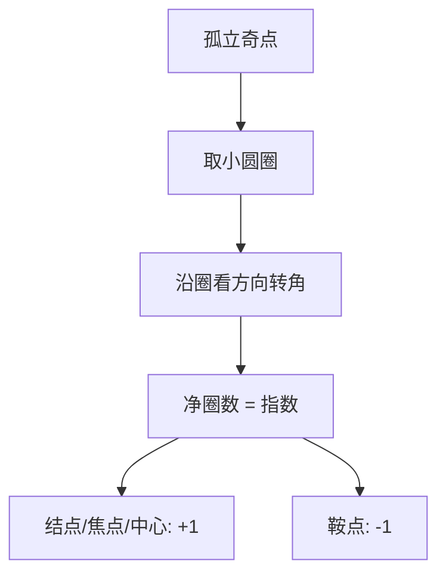

# 向量场奇点的指数

- **难度**：高难 | **涉及章节**：第 7 章

## 一句话定义
沿包围孤立奇点的小圈走一圈，向量场方向转过的净圈数（整数）。

## 为什么重要
它是拓扑不变量：连续变形不改变它，因此可以用来"数"奇点，而不必逐个分析。

## 图示

## 详解
指数的可加性：区域内多个奇点的指数之和等于边界曲线的绕数。由此可证球面上向量场总指数为 2（毛球定理）。

## 常见误解
- 别以为指数决定稳定性（+1 可能稳也可能不稳）。
- 别以为指数对非孤立奇点有定义。
- 别以为指数是连续量（它是整数）。

## 在书中出现的脉络
| 章节 | 语境 | 关键结论 |
|---|---|---|
| 第 7 章 | §36 奇点指数 | 拓扑不变量 |

## 相关概念
- 前置：绕数、同伦
- 后续：庞加莱-霍普夫定理
